# PRODUCT REQUIREMENTS DOCUMENT (PRD)

# LANDURYKU

## Laundry Marketplace + AI Chat Assistant

**Product Name:** LANDURYKU
**Product Type:** Laundry Marketplace
**Document Type:** Product Requirements Document
**Status:** Draft for Business & Product Review
**Date:** 29 August 2026
**Primary Platform:** Responsive Web / Mobile-Friendly
**Architecture:** MVC
**Document Audience:** Product Owner, Business Stakeholder, UX/UI Designer, Developer, QA, Security Engineer, Payment/Finance Team, AI/Product Team

---

# 1. Executive Summary

**LANDURYKU** adalah platform marketplace laundry berbasis web yang mempertemukan:

* **Customer** (Pengguna / Pelanggan laundry);
* **Kurir** (Petugas penjemputan dan pengantaran laundry);
* **Admin Toko** (Pemilik / Pengelola mitra toko laundry);
* **Super Admin** (Administrator pengelola seluruh platform marketplace).

Customer dapat menemukan laundry berdasarkan lokasi, melihat layanan dan harga, membuat order pickup/delivery, memilih pembayaran **Online Payment melalui Xendit** atau **COD**, memantau status laundry, serta melihat posisi kurir ketika proses pickup/delivery berlangsung.

LANDURYKU juga dilengkapi **AI Chat Assistant** yang membantu customer mendapatkan informasi mengenai layanan, harga, order, pembayaran, dan pertanyaan umum.

Mitra Laundry melalui Admin Toko dapat mendaftarkan bisnisnya, mengelola layanan dan harga, menerima dan memproses order, mengelola kurir, serta melihat laporan operasional dan pendapatan.

Kurir dapat menerima tugas pickup/delivery, memperbarui status perjalanan, dan mengirimkan lokasi GPS selama task aktif.   

Super Admin bertugas mengelola seluruh ekosistem marketplace, verifikasi toko baru, manajemen pengguna, pemantauan transaksi payment & refund, pengaturan komisi, konfigurasi sistem, audit log, dan keamanan.

Produk dirancang sebagai marketplace **multi-store dan multi-tenant** dengan pendekatan security:

> **Defense in Depth + Least Privilege + Zero Trust Resource Authorization**

---

# 2. Product Vision

## Vision

> Menjadi platform digital yang membuat proses mencari, memesan, mengambil, mencuci, membayar, dan mengantarkan laundry menjadi mudah, transparan, aman, dan dapat dilacak dari awal hingga selesai.

## Product Principles

1. Customer First.
2. Trust & Safety.
3. Operational Transparency.
4. Fair Marketplace.
5. Least Privilege.
6. Automation with Human Control.
7. Scalable by Design.
8. Secure by Default.
9. Data Minimization.
10. System of Record sebagai sumber kebenaran transaksi.

---

# 3. Problem Statement

## 3.1 Customer

Masalah:

* Sulit menemukan laundry terpercaya di sekitar lokasi.
* Sulit membandingkan harga dan layanan antar laundry.
* Customer harus menghubungi laundry secara manual.
* Pickup dan delivery belum terorganisasi dan minim kepastian.
* Customer tidak mengetahui posisi kurir penjemput/pengantar.
* Customer tidak selalu mengetahui harga final sebelum laundry ditimbang.
* Informasi pembayaran dapat membingungkan.
* Customer harus menghubungi CS untuk pertanyaan sederhana.

## 3.2 Laundry Store (Admin Toko)

Masalah:

* Sulit memperoleh customer digital dan memperluas jangkauan pasar.
* Pengelolaan order dan pencatatan operasional masih manual.
* Sulit mengelola dan memantau tugas kurir.
* Tidak memiliki platform marketplace discovery mandiri.
* Tidak memiliki sistem tracking status pengerjaan laundry yang terintegrasi.

## 3.3 Kurir

Masalah:

* Tidak memiliki sistem assignment tugas yang terstruktur.
* Informasi alamat dan instruksi pickup/delivery sering tidak konsisten.
* Tidak memiliki sistem konfirmasi bukti serah terima (proof of delivery/pickup).
* Tidak ada sistem navigasi dan live tracking tugas terorganisasi.

## 3.4 Platform (Super Admin)

Masalah:

* Membutuhkan multi-tenant security dan isolasi data toko yang ketat.
* Membutuhkan payment gateway terpusat dan refund management yang akurat.
* Membutuhkan audit trail dan rekonsiliasi keuangan/komisi otomatis.
* Membutuhkan sistem notifikasi real-time ke semua pihak.
* Membutuhkan AI dengan security boundary yang ketat.

---

# 4. Goals

## 4.1 Primary Goals

1. Menyediakan marketplace laundry multi-store dengan 4 role utama: Customer, Kurir, Admin Toko, dan Super Admin.
2. Memungkinkan customer menemukan laundry berdasarkan lokasi.
3. Menyediakan order pickup dan delivery end-to-end.
4. Menyediakan transparansi estimated dan actual weight (penimbangan transparan).
5. Mendukung pembayaran online melalui **Xendit** (QRIS, VA, E-Wallet).
6. Mendukung pembayaran tunai **COD (Cash on Delivery)**.
7. Menyediakan courier assignment dan task management.
8. Menyediakan live GPS tracking untuk pickup dan delivery.
9. Menyediakan AI Chat Assistant untuk bantuan informasi pelanggan.
10. Menyediakan RBAC dan permission system berbasis 4 role.
11. Menyediakan tenant isolation antar toko.
12. Menyediakan audit trail dan activity log.
13. Menyediakan sistem notification multi-channel.
14. Menyediakan refund dan dispute management.
15. Menyediakan marketplace yang responsive dan mobile-friendly.

## 4.2 Business Goals

* Meningkatkan jumlah customer aktif dan pesanan harian.
* Meningkatkan jumlah mitra laundry partner terverifikasi.
* Meningkatkan volume transaksi marketplace (GMV).
* Meningkatkan customer retention dan loyalitas pengguna.
* Menghasilkan revenue platform melalui potongan komisi per transaksi yang adil.
* Mengurangi beban operasional support melalui AI Assistant.

---

# 5. Non-Goals

MVP tidak bertujuan untuk:

* Membuat payment processor sendiri (menggunakan Xendit).
* Menjadi bank atau e-wallet independen.
* Melatih model AI dari nol (menggunakan API LLM terintegrasi).
* Menggantikan seluruh CS manusia secara total.
* Membuat full-scale ERP manufaktur laundry berskala pabrik.
* Membuat sistem navigasi peta sendiri (menggunakan peta digital/Google Maps API).
* Menyediakan native mobile application (fokus responsive web application).
* Menyimpan raw payment credentials (keamanan diserahkan ke Xendit).
* Menyediakan autonomous AI transaction execution tanpa konfirmasi user.

---

# 6. Target Users

| Role | Deskripsi & Tujuan |
| --- | --- |
| **Customer** | Pelanggan yang mencari toko laundry, membuat pesanan, memilih layanan & jadwal antar-jemput, melakukan pembayaran (Online/COD), melacak status cucian & GPS kurir, memberikan rating/ulasan, dan berkonsultasi via AI Assistant. |
| **Kurir** | Petugas penjemputan dan pengantaran laundry yang bertugas menerima penugasan task, navigasi ke lokasi, membagikan posisi live GPS, mengunggah bukti serah terima (foto pickup/delivery), dan mengonfirmasi pembayaran tunai COD. |
| **Admin Toko** | Pemilik dan pengelola mitra toko laundry yang bertugas mengelola profil toko, katalog layanan & tarif harga, jam operasional, radius layanan, pengaturan COD, pemrosesan order (input timbangan riil, update status cuci), penugasan kurir, dan memantau omset penjualan. |
| **Super Admin** | Administrator tertinggi pengelola platform yang bertugas memverifikasi pendaftaran mitra laundry baru, memoderasi toko/user, memantau transaksi Xendit & keuangan, mengelola komisi platform, memproses refund, melihat audit log, dan mengelola konfigurasi global sistem. |

---

# 7. User Roles & Permission Specification

## 7.1 Super Admin

Super Admin merupakan otoritas administrator tertinggi di platform LANDURYKU.

### Wewenang & Tanggung Jawab:
* Mengelola seluruh platform marketplace dan parameter global sistem.
* Melakukan verifikasi, approval, permintaan revisi, atau penolakan pendaftaran mitra laundry baru.
* Melakukan suspend / blacklist terhadap toko laundry atau akun pengguna yang melanggar ketentuan.
* Mengelola dan memantau akun seluruh pengguna (Customer, Kurir, Admin Toko).
* Mengatur skema dan persentase komisi platform.
* Memantau transaksi pembayaran terintegrasi Xendit dan laporan keuangan platform.
* Mengelola dan menyetujui proses refund / penyelesaian sengketa transaksi.
* Mengakses Audit Trail global untuk pemantauan keamanan dan integritas data.

### Aturan Keamanan:
* Super Admin **tidak dapat didaftarkan melalui form registrasi publik**.
* Akun Super Admin dibuat via provisioning internal / database seeding aman.
* Wajib menggunakan Enhanced Authentication (Password kuat + Multi-Factor / 2FA).

---

## 7.2 Admin Toko

Admin Toko merupakan pemilik sekaligus pengelola operasional dari mitra toko laundry yang terdaftar.

### Wewenang & Tanggung Jawab:
* Melakukan registrasi toko dan pengajuan verifikasi mitra (*Store Onboarding*).
* Mengelola profil toko: nama laundry, deskripsi, logo/foto, alamat lengkap, titik koordinat peta, dan jam operasional.
* Mengelola katalog layanan (Kiloan, Satuan, Dry Clean, Express, dll.) beserta rincian tarif harga.
* Mengatur parameter operasional toko: radius jangkauan jemput/antar, biaya pengiriman, minimum order, dan ketersediaan opsi COD.
* Mengelola operasional pesanan:
  * Menerima notifikasi dan mengonfirmasi pesanan baru.
  * Menugaskan kurir untuk penjemputan (*Pickup Assignment*).
  * Melakukan penimbangan aktual (*Weighing*) dan menginput berat riil serta foto bukti ke sistem.
  * Memperbarui status pengerjaan laundry (*Washing*, *Drying*, *Ironing*, *Packed/Ready*).
  * Menugaskan kurir untuk pengantaran (*Delivery Assignment*).
  * Menyelesaikan pesanan.
* Mengelola akun kurir internal toko (membuat akun kurir, memantau tugas kurir).
* Melihat laporan keuangan toko: omset harian/bulanan, rekapitulasi pesanan, dan penarikan dana (*settlement*).

### Aturan Keamanan & Isolasi:
* Terisolasi secara penuh dalam ruang lingkup (*tenant scope*) tokonya sendiri.
* Tidak memiliki akses ke data toko lain, konfigurasi global platform, atau audit log Super Admin.

---

## 7.3 Kurir

Kurir bertugas melakukan logistik penjemputan dan pengantaran cucian antara customer dan toko laundry.

### Wewenang & Tanggung Jawab:
* Mengatur status ketersediaan kerja (*Toggle Online/Offline*).
* Menerima notifikasi penugasan tugas penjemputan (*Pickup Task*) dan pengantaran (*Delivery Task*).
* Melihat detail tugas yang ditugaskan: nama pelanggan, nomor kontak, alamat lengkap penjemputan/pengantaran, dan catatan khusus.
* Membagikan posisi koordinat GPS secara berkala saat tugas sedang berjalan (*Live GPS Tracking*).
* Mengunggah bukti foto serah terima (*Proof of Pickup* dan *Proof of Delivery*).
* Menerima uang pembayaran tunai dari customer jika metode pembayaran adalah COD dan mencatatnya ke sistem.
* Melihat riwayat tugas penjemputan/pengantaran harian yang telah diselesaikan.

### Aturan Keamanan:
* Hanya dapat mengakses data pesanan dan alamat pelanggan yang secara aktif ditugaskan kepadanya.
* Tidak memiliki akses ke pengelolaan harga, katalog layanan toko, maupun laporan keuangan toko.

---

## 7.4 Customer

Customer merupakan pengguna akhir yang memesan dan menikmati layanan laundry melalui marketplace.

### Wewenang & Tanggung Jawab:
* Mendaftar dan mengelola profil akun pelanggan serta buku alamat (termasuk titik koordinat penjemputan).
* Mencari dan memfilter mitra toko laundry berdasarkan lokasi terdekat, rating, harga, dan layanan.
* Membuat pesanan laundry dengan memilih layanan, estimasi berat/jumlah, jadwal pickup, dan catatan instruksi.
* Memilih opsi pengiriman: Antar-Jemput oleh kurir (*Pickup & Delivery*) atau antar mandiri (*Drop-off/Self Pickup*).
* Memilih metode pembayaran: Pembayaran Online via Xendit (QRIS, E-Wallet, Virtual Account) atau Tunai di tempat (COD).
* Memantau status pesanan secara real-time dan melacak posisi kurir melalui peta GPS live.
* Menerima notifikasi penyesuaian tagihan setelah penimbangan riil oleh Admin Toko.
* Memberikan ulasan bintang dan ulasan tertulis kepada Toko Laundry dan Kurir setelah pesanan selesai.
* Menggunakan fitur AI Chat Assistant untuk konsultasi seputar layanan, status order, dan panduan perawatan pakaian.
* Melihat riwayat seluruh transaksi pesanan.

---

# 8. User Journey & Alur Pengguna (Login s/d Logout)

Berikut adalah alur lengkap perjalanan pengguna (*End-to-End User Flow*) untuk masing-masing dari 4 role, mulai dari proses Login hingga Logout:

```mermaid
flowchart TD
    subgraph CustomerFlow["1. Customer Flow"]
        C1[1. Akses Web & Login / Register] --> C2[2. Dashboard & Pencarian Toko Laundry]
        C2 --> C3[3. Pilih Layanan & Buat Pesanan]
        C3 --> C4[4. Checkout & Pilih Pembayaran: Xendit / COD]
        C4 --> C5[5. Tracking Kurir Pickup & Penimbangan Toko]
        C5 --> C6[6. Tracking Proses Cuci & Kurir Delivery]
        C6 --> C7[7. Terima Laundry, Pelunasan COD, Beri Rating]
        C7 --> C8[8. Riwayat Transaksi / Tanya AI]
        C8 --> C9[9. Logout & Selesai]
    end

    subgraph KurirFlow["2. Kurir Flow"]
        K1[1. Login Akun Kurir] --> K2[2. Dashboard & Aktifkan Status Siap Kerja]
        K2 --> K3[3. Notifikasi Tugas Pickup / Delivery]
        K3 --> K4[4. Navigasi ke Lokasi + Aktifkan Live GPS]
        K4 --> K5[5. Serah Terima Pakaian & Upload Foto Bukti]
        K5 --> K6[6. Update Status Task & Terima Uang COD jika ada]
        K6 --> K7[7. Rekap Riwayat Tugas Harian]
        K7 --> K8[8. Nonaktifkan Status Kerja & Logout]
    end

    subgraph AdminTokoFlow["3. Admin Toko Flow"]
        A1[1. Login Akun Admin Toko] --> A2[2. Dashboard Toko & Pengaturan Layanan/Harga/COD]
        A2 --> A3[3. Notifikasi & Konfirmasi Order Baru]
        A3 --> A4[4. Penugasan Kurir Pickup Toko]
        A4 --> A5[5. Timbang Berat Riil & Update Tagihan Final]
        A5 --> A6[6. Update Status Cuci: Washing - Drying - Ironing - Ready]
        A6 --> A7[7. Penugasan Kurir Delivery & Konfirmasi Selesai]
        A7 --> A8[8. Cek Laporan Penjualan & Saldo Toko]
        A8 --> A9[9. Logout Akun Toko]
    end

    subgraph SuperAdminFlow["4. Super Admin Flow"]
        S1[1. Login Super Admin dengan Enhanced Auth/2FA] --> S2[2. Master Dashboard Platform: GMV, Toko & User Aktif]
        S2 --> S3[3. Review & Verifikasi Pendaftaran Mitra Toko Baru]
        S3 --> S4[4. Manajemen & Moderasi Pengguna Global]
        S4 --> S5[5. Monitoring Transaksi Xendit, Komisi & Refund]
        S5 --> S6[6. Audit Log, Sistem Keamanan & Konfigurasi Global]
        S6 --> S7[7. Secure Logout & Invalidate Session]
    end
```



---

## 8.1 Alur Pengguna: Customer

```text
[1. Akses & Autentikasi]
   ├─ Buka web LANDURYKU di browser (Desktop / Mobile).
   ├─ Melakukan Register (jika user baru) atau Login dengan Email & Password / OAuth.
   └─ Masuk ke halaman utama Customer; melengkapi profil & menyimpan pin alamat penjemputan.

[2. Eksplorasi & Pemilihan Toko]
   ├─ Menggunakan fitur pencarian laundry terdekat berbasis lokasi GPS / filter manual.
   ├─ Memfilter toko berdasarkan jarak, rating bintang, harga layanan, atau promo.
   └─ Memilih toko laundry mitra dan melihat detail halaman toko (profil, ulasan, katalog layanan).

[3. Pemesanan & Pemilihan Layanan]
   ├─ Memilih item layanan (Kiloan, Satuan, Express, dll.).
   ├─ Memasukkan perkiraan berat / jumlah baju serta catatan khusus (misal: "jangan campur pakaian putih").
   ├─ Memilih metode logistik: Antar-Jemput (Pickup & Delivery) atau Antar Mandiri (Drop-off).
   └─ Menentukan alamat dan estimasi waktu penjemputan (Pickup Time).

[4. Checkout & Pembayaran]
   ├─ Memeriksa ringkasan checkout: Rincian estimasi biaya layanan + ongkir + biaya platform.
   ├─ Memilih metode pembayaran:
   │    ├─ Online Payment (Xendit): QRIS, Virtual Account Bank, atau E-Wallet (bayar instan).
   │    └─ COD (Cash on Delivery): Bayar tunai saat pakaian bersih selesai diantar.
   └─ Konfirmasi pesanan -> Pesanan resmi dibuat (Status: PENDING_CONFIRMATION / ORDER_CONFIRMED).

[5. Pelacakan Penjemputan & Penimbangan]
   ├─ Menerima notifikasi penugasan kurir penjemputan.
   ├─ Memantau posisi kurir penjemput di peta real-time via Live GPS Tracking.
   ├─ Menyerahkan cucian kotor ke kurir saat kurir tiba di lokasi penjemputan.
   └─ Menerima notifikasi penimbangan riil dari toko (berat riil & foto timbangan; penyesuaian nominal tagihan jika berbeda).

[6. Pelacakan Proses Cuci & Pengantaran]
   ├─ Memantau progress pengerjaan laundry (Dicuci -> Dikeringkan -> Disetrika -> Siap Diantar).
   ├─ Menerima notifikasi saat pesanan mulai diantar oleh kurir.
   └─ Memantau live GPS kurir pengantar hingga tiba di alamat tujuan.

[7. Penerimaan, Pelunasan & Ulasan]
   ├─ Menerima paket cucian bersih dari kurir.
   ├─ Melakukan pembayaran tunai ke kurir jika memilih opsi COD.
   └─ Memberikan penilaian (bintang 1-5) dan ulasan pengalaman layanan untuk Toko & Kurir.

[8. Interaksi Tambahan & Logout]
   ├─ Memeriksa ringkasan transaksi di menu Riwayat Pesanan.
   ├─ (Opsional) Menggunakan fitur AI Chat Assistant untuk bantuan informasi.
   └─ Membuka Menu Profil -> Klik tombol "Logout" -> Sesi berakhir secara aman.
```

---

## 8.2 Alur Pengguna: Kurir

```text
[1. Autentikasi & Masuk]
   ├─ Buka web portal LANDURYKU.
   ├─ Login menggunakan kredensial akun Kurir yang telah didaftarkan dan diverifikasi.
   └─ Masuk ke halaman Kurir Workspace.

[2. Dashboard & Status Kesiapan Kerja]
   ├─ Melihat ringkasan dashboard tugas harian (tugas baru, sedang berjalan, selesai).
   └─ Mengaktifkan tombol toggle status kerja: "Online / Siap Menerima Tugas".

[3. Eksekusi Tugas Penjemputan (Pickup Task)]
   ├─ Menerima notifikasi penugasan Pickup dari Admin Toko.
   ├─ Membuka rincian tugas: Nama customer, nomor WhatsApp/telepon, alamat penjemputan & catatan.
   ├─ Mengklik tombol "Mulai Penjemputan" -> Sistem otomatis mengaktifkan Live GPS Tracking.
   ├─ Melakukan perjalanan ke titik penjemputan customer.
   ├─ Tiba di lokasi -> Mengambil cucian kotor dari customer.
   ├─ Mengambil foto bukti serah terima (Proof of Pickup) & upload ke sistem.
   ├─ Mengubah status task menjadi "Pakaian Diambil (Picked Up)".
   └─ Membawa cucian ke Toko Laundry -> Menyerahkan cucian ke Admin Toko -> Konfirmasi "Tiba di Toko".

[4. Eksekusi Tugas Pengantaran (Delivery Task)]
   ├─ Menerima notifikasi penugasan Delivery untuk cucian yang sudah selesai dicuci & dipacking.
   ├─ Mengambil paket cucian bersih di Toko Laundry.
   ├─ Mengklik tombol "Mulai Pengantaran" -> Sistem mengaktifkan Live GPS Tracking.
   ├─ Melakukan navigasi perjalanan ke alamat customer.
   ├─ Tiba di lokasi -> Menyerahkan paket cucian bersih kepada customer.
   ├─ (Khusus Pembayaran COD) Menagih dan menerima uang tunai sesuai tagihan -> Konfirmasi pembayaran COD di sistem.
   ├─ Mengambil foto bukti penerimaan (Proof of Delivery) & upload ke sistem.
   └─ Mengubah status pesanan menjadi "Selesai Diantar (Delivered)".

[5. Rekapitulasi & Selesai Bertugas]
   ├─ Melihat rekapitulasi jumlah tugas pickup & delivery yang berhasil diselesaikan pada hari itu.
   ├─ Menyerahkan setoran uang tunai COD kepada Admin Toko pada penutupan shift.
   ├─ Mengubah status kerja menjadi "Offline / Selesai Bertugas" (Live GPS berhenti).
   └─ Membuka menu Akun Kurir -> Klik tombol "Logout" -> Sesi kurir ditutup.
```

---

## 8.3 Alur Pengguna: Admin Toko

```text
[1. Autentikasi & Masuk]
   ├─ Mengakses portal web LANDURYKU.
   ├─ Login dengan Email & Password akun Admin Toko.
   └─ Masuk ke Dashboard Operasional Toko Laundry.

[2. Dashboard & Pengaturan Toko]
   ├─ Melihat ringkasan metrik toko: Pesanan baru, pesanan sedang dicuci, pesanan siap kirim, omset harian.
   ├─ Mengatur status operasional toko: Buka / Tutup.
   ├─ Mengelola katalog layanan (menambah layanan, mengatur tarif harga per kg / satuan / express).
   ├─ Mengatur parameter pengiriman: Radius jangkauan (km), tarif ongkir, minimum order, dan toggle COD.
   └─ Mengelola akun kurir internal toko.

[3. Siklus Pemrosesan Pesanan (Order Lifecycle)]
   ├─ Menerima notifikasi pesanan masuk dari customer.
   ├─ Memeriksa detail pesanan -> Klik "Terima Pesanan".
   ├─ Menugaskan kurir toko untuk melakukan penjemputan pakaian ke alamat customer (Pickup Assignment).
   ├─ Menerima pakaian kotor yang dibawa oleh kurir / diantar langsung oleh customer ke toko.
   ├─ Menimbang pakaian dengan timbangan digital -> Menginput berat aktual (Actual Weight) dan upload foto timbangan.
   ├─ Sistem menghitung ulang total tagihan secara otomatis dan mengirim notifikasi update ke customer.
   ├─ Memulai pengerjaan laundry dan mengupdate status pengerjaan bertahap di sistem:
   │    ├─ "Washing" (Pakaian sedang dicuci)
   │    ├─ "Drying" (Pakaian sedang dikeringkan)
   │    ├─ "Ironing" (Pakaian sedang disetrika)
   │    └─ "Ready for Delivery/Pickup" (Pakaian selesai dipacking rapi).
   ├─ Menugaskan kurir untuk mengantar cucian bersih ke customer (Delivery Assignment).
   └─ Memantau konfirmasi pengantaran sukses dari kurir (Proof of Delivery).

[4. Laporan, Keuangan & Logout]
   ├─ Memeriksa laporan penjualan harian/bulanan dan ulasan/rating dari pelanggan.
   ├─ Memeriksa saldo pendapatan bersih toko dan riwayat settlement pencairan dana.
   └─ Membuka menu Pengaturan Toko -> Klik tombol "Logout" -> Sesi operasional toko ditutup.
```

---

## 8.4 Alur Pengguna: Super Admin

```text
[1. Autentikasi Super Admin & Keamanan]
   ├─ Mengakses portal administratif khusus Super Admin.
   ├─ Melakukan login menggunakan kredensial administrator + Enhanced Authentication / 2FA.
   └─ Masuk ke Super Admin Master Control Panel.

[2. Master Dashboard Platform]
   ├─ Memantau metrik ekosistem platform secara makro:
   │    ├─ Total GMV (Gross Merchandise Value) & Total Pendapatan Komisi Platform.
   │    ├─ Jumlah pesanan aktif dan selesai di seluruh toko.
   │    ├─ Jumlah mitra toko aktif vs toko pending verifikasi.
   │    └─ Jumlah customer dan kurir aktif.
   └─ Memantau system alert & antrean task administratif.

[3. Verifikasi & Moderasi Mitra Toko]
   ├─ Membuka modul "Verifikasi Mitra Laundry":
   │    ├─ Meninjau permohonan pendaftaran toko baru (data pemilik, identitas, legalitas, lokasi toko, foto tempat).
   │    └─ Mengambil tindakan: "Approve" (toko aktif di marketplace), "Request Revision" (minta perbaikan data), atau "Reject" (tolak).
   └─ Melakukan pengawasan kualitas & tindakan penangguhan (Suspend/Freeze) bagi toko yang melanggar aturan.

[4. Manajemen Pengguna Global (User Management)]
   ├─ Memantau seluruh daftar pengguna platform (Customer, Kurir, Admin Toko).
   └─ Melakukan tindakan administratif bila diperlukan (reset autentikasi, investigasi akun mencurigakan, suspend user).

[5. Pemantauan Finansial, Xendit Gateway & Refund]
   ├─ Memantau log transaksi gateway pembayaran Xendit (sukses, expired, refund).
   ├─ Mengatur persentase/skema komisi platform per transaksi.
   ├─ Memproses & menyetujui pengajuan Refund / penanganan komplain sengketa transaksi.
   └─ Memantau jadwal rekonsiliasi dan settlement dana ke mitra toko.

[6. Audit Log, Konfigurasi Sistem & Logout]
   ├─ Memeriksa Audit Log keamanan sistem (mencatat semua aksi krusial platform).
   ├─ Mengelola konfigurasi parameter global platform (kebijakan operasional, AI configuration).
   └─ Mengklik menu profil Super Admin -> Memilih "Logout" -> Sistem melakukan secure token invalidation.
```

---

# 9. Marketplace

Customer dapat menemukan laundry berdasarkan:

* lokasi;
* nama;
* service;
* rating;
* harga;
* jarak;
* availability.

## Filter

* jarak;
* harga;
* rating;
* service;
* pickup availability;
* delivery availability;
* operating hours.

## Store Ranking

Ranking dapat mempertimbangkan:

* jarak;
* rating;
* review;
* availability;
* service match;
* operational performance.

**[NEEDS BUSINESS DECISION]**

Apakah ranking akan mendukung sponsored store placement.

---

# 10. Store Registration

Istilah UI:

> **Daftarkan Laundry**

Alternatif:

> **Gabung sebagai Mitra Laundry**

Public user tidak dapat mendaftar sebagai Super Admin.

---

# 11. Store Onboarding Flow

```text
Daftarkan Laundry
→ Login/Register
→ Data Pemilik
→ Data Laundry
→ Lokasi
→ Jam Operasional
→ Layanan
→ Harga
→ Pickup & Delivery
→ Courier
→ Settlement
→ Dokumen
→ Review
→ Submit
→ Under Review
→ Approved / Revision / Rejected
→ Store Active
```

---

# 12. Owner Data

Data pemilik:

* nama;
* email;
* nomor telepon;
* WhatsApp;
* alamat;
* identity information sesuai kebutuhan verifikasi.

Placeholder:

```text
[OWNER_NAME]
[OWNER_EMAIL]
[OWNER_PHONE]
[OWNER_WHATSAPP]
[OWNER_ADDRESS]
```

---

# 13. Store Data

Minimal:

* nama laundry;
* logo;
* deskripsi;
* phone;
* WhatsApp;
* alamat;
* RT/RW;
* kelurahan;
* kecamatan;
* kabupaten/kota;
* provinsi;
* kode pos;
* latitude;
* longitude;
* operating hours.

Placeholder:

```text
[STORE_NAME]
[STORE_LOGO]
[STORE_DESCRIPTION]
[STORE_PHONE]
[STORE_WHATSAPP]
[STORE_ADDRESS]
[STORE_RT_RW]
[STORE_LATITUDE]
[STORE_LONGITUDE]
```

---

# 14. Business Data

Store dapat menentukan:

* jenis laundry;
* layanan;
* harga;
* minimum order;
* pickup fee;
* delivery fee;
* service radius;
* service area;
* operating schedule;
* COD availability.

Settlement information hanya dapat diakses oleh authorized role.

---

# 15. Store Application Status

Status:

```text
DRAFT
SUBMITTED
UNDER_REVIEW
REVISION_REQUIRED
RESUBMITTED
APPROVED
REJECTED
SUSPENDED
```

## Rules

DRAFT:

> Applicant dapat mengedit.

SUBMITTED:

> Applicant tidak dapat mengubah data tertentu sampai application dikembalikan/revision.

UNDER_REVIEW:

> Reviewer memeriksa application.

REVISION_REQUIRED:

> Applicant harus memperbaiki data.

RESUBMITTED:

> Application dikirim kembali.

APPROVED:

> Store dapat aktif.

REJECTED:

> Application ditolak.

SUSPENDED:

> Store tidak dapat menerima order baru.

---

# 16. Approval

Authorized reviewer dapat:

* approve;
* reject;
* request revision;
* suspend.

Setiap action harus:

* tercatat;
* memiliki actor;
* memiliki timestamp;
* memiliki reason jika diperlukan;
* menghasilkan notification.

---

# 17. Marketplace Store Eligibility

Store hanya dapat menerima order jika:

```text
APPROVED
+
ACTIVE
+
SERVICE AVAILABLE
+
WITHIN SERVICE AREA
```

Store `SUSPENDED` tidak boleh menerima order baru.

---

# 18. Order Management

Order memiliki:

* order ID;
* order reference;
* customer;
* store;
* service;
* estimated weight/quantity;
* actual weight;
* estimated price;
* final price;
* address;
* pickup/delivery;
* courier;
* payment;
* order status;
* timestamps.

---

# 19. Order Flow

```text
CREATED
↓
WAITING_PICKUP
↓
COURIER_ASSIGNED
↓
COURIER_TO_CUSTOMER
↓
PICKED_UP
↓
IN_TRANSIT_TO_STORE
↓
RECEIVED_BY_STORE
↓
WEIGHED
↓
PAYMENT_REQUIRED
↓
PAID
↓
PROCESSING
↓
READY_FOR_DELIVERY
↓
COURIER_ASSIGNED
↓
OUT_FOR_DELIVERY
↓
DELIVERED
↓
COMPLETED
```

Tidak semua order harus melewati state yang sama jika pickup/delivery tidak digunakan.

---

# 20. Weight Management

Sistem menyimpan:

* estimated weight;
* actual weight.

Contoh:

```text
Estimated Weight = 5 KG
Actual Weight    = 6.5 KG
```

Keduanya tidak boleh saling overwrite.

---

# 21. Price Calculation

Estimated:

```text
Estimated Weight × Service Price
```

Final:

```text
Actual Weight × Applicable Service Price
+ Pickup Fee
+ Delivery Fee
+ Platform Fee
- Discount
```

Formula final harus dihitung server-side.

Browser tidak boleh menentukan final amount.

---

# 22. Price Change

Jika actual weight menyebabkan perubahan harga signifikan:

* customer diberi notification;
* final price diperbarui;
* customer dapat diberikan confirmation sesuai policy.

Threshold:

```text
[PRICE_CHANGE_CONFIRMATION_THRESHOLD]
```

---

# 23. Laundry Processing

Status:

```text
RECEIVED
→ WEIGHED
→ WASHING
→ DRYING
→ IRONING
→ PACKING
→ READY
```

Store hanya dapat melakukan transition yang diperbolehkan.

---

# 24. Courier Management

Courier terbagi menjadi:

## Marketplace Courier

Dikelola platform.

Dapat melayani beberapa store berdasarkan operational scope.

## Store Courier

Dikelola Store Owner.

Hanya dapat menerima task dalam scope store.

---

# 25. Courier Registration

Minimal:

* name;
* phone;
* profile;
* operational area;
* verification;
* vehicle information bila diperlukan.

Placeholder:

```text
[COURIER_REQUIREMENTS]
[COURIER_DOCUMENT_REQUIREMENTS]
```

---

# 26. Courier Assignment

Courier hanya dapat menerima task jika:

* active;
* verified;
* available;
* berada dalam service area;
* tidak memiliki conflicting active task.

Jika courier menolak:

```text
ASSIGNED
→ REJECTED
→ REASSIGNMENT
```

Repeated rejection dapat dimonitor.

---

# 27. GPS Tracking

GPS digunakan untuk:

* pickup;
* delivery.

Flow:

```text
Courier GPS
→ Realtime Service
→ LANDURYKU
→ Customer Map
```

GPS hanya aktif selama active task.

Tracking berhenti ketika:

* task completed;
* task cancelled;
* courier tidak lagi memiliki active task.

---

# 28. GPS Privacy

Rules:

1. GPS tidak aktif tanpa active task.
2. Customer hanya melihat courier terkait order.
3. Store hanya melihat courier task dalam scope.
4. GPS history memiliki retention terbatas.
5. GPS tidak boleh dipakai untuk tujuan lain tanpa policy.
6. Access GPS diaudit untuk role privileged.

---

# 29. Payment

LANDURYKU menggunakan:

> **Xendit sebagai payment gateway resmi untuk online payment.**

LANDURYKU menyediakan:

1. Online Payment melalui Xendit.
2. QRIS melalui Xendit.
3. COD.

**Midtrans tidak digunakan.**

---

# 30. Online Payment — Xendit

Online payment dilakukan melalui Xendit.

Flow:

```text
Customer Checkout
↓
Select Online Payment
↓
LANDURYKU Create Payment
↓
Xendit
↓
Customer Payment
↓
Xendit Processing
↓
Xendit Webhook
↓
LANDURYKU Verification
↓
Payment = PAID
↓
Order Continue
```

LANDURYKU tidak menyimpan:

* card number;
* CVV;
* payment password;
* raw payment credential.

Data tersebut ditangani oleh payment provider sesuai mekanisme Xendit.

---

# 31. QRIS — Xendit

Customer dapat memilih QRIS jika QRIS aktif pada konfigurasi Xendit LANDURYKU.

Flow:

```text
Checkout
↓
Online Payment
↓
QRIS
↓
Xendit
↓
QRIS Display
↓
Customer Pays
↓
Xendit
↓
Webhook
↓
Verification
↓
PAID
```

QRIS tidak dibuat secara manual oleh LANDURYKU.

---

# 32. Payment Expiration

Online payment memiliki batas:

> **1 jam sejak payment dibuat.**

Flow:

```text
PENDING
↓
1 HOUR
↓
EXPIRED
```

Jika belum dibayar:

* payment expired;
* customer diberi notification;
* order mengikuti expiration policy;
* tidak ada refund karena belum ada successful payment.

Jika customer ingin melakukan pembayaran kembali, sistem dapat membuat payment baru.

Payment baru harus memiliki reference/idempotency baru.

---

# 33. COD — Cash on Delivery

LANDURYKU menyediakan COD.

COD digunakan apabila order memenuhi:

```text
COD_ENABLED
+
STORE_ALLOWED
+
AREA_ALLOWED
+
CUSTOMER_ELIGIBLE
+
ORDER_VALUE_ALLOWED
```

Flow:

```text
Customer Checkout
↓
Select COD
↓
Order Created
↓
Courier Assignment
↓
Pickup / Delivery
↓
Customer Gives Cash
↓
COD Verification
↓
Payment = PAID
```

---

# 34. COD Verification

Courier tidak boleh mengubah payment menjadi `PAID` hanya dengan tombol sederhana.

Metode verifikasi:

```text
[COD_VERIFICATION_METHOD]
```

Pilihan dapat berupa:

* OTP;
* PIN;
* customer confirmation;
* QR confirmation;
* metode lain yang ditentukan bisnis.

Minimum evidence:

* order ID;
* payment ID;
* amount;
* customer ID;
* courier ID;
* timestamp;
* verification method;
* verification result.

---

# 35. COD Configuration

Configurable:

```text
COD_ENABLED = [TRUE/FALSE]

COD_MAX_AMOUNT = [COD_MAX_AMOUNT]

COD_ALLOWED_AREA = [COD_ALLOWED_AREA]

COD_ALLOWED_STORE = [COD_ALLOWED_STORE]

COD_VERIFICATION_METHOD = [COD_VERIFICATION_METHOD]
```

---

# 36. Payment Status

Payment status terpisah dari order status.

## Online

```text
PENDING
PAID
FAILED
EXPIRED
REFUND_REQUESTED
REFUND_PROCESSING
REFUNDED
```

## COD

```text
PENDING
PAID
CANCELLED
```

---

# 37. Xendit Webhook

Webhook Xendit wajib diverifikasi.

Sistem harus:

1. memvalidasi authenticity;
2. memvalidasi reference;
3. memvalidasi order;
4. memvalidasi nominal;
5. memvalidasi state;
6. menerapkan idempotency;
7. mencegah duplicate processing;
8. mencatat event;
9. membuat notification setelah state valid.

---

# 38. Duplicate Webhook

Jika webhook yang sama diterima dua kali:

```text
Webhook #1
↓
Process
↓
PAID

Webhook #2
↓
Duplicate Detection
↓
Ignore / Idempotent Handling
```

Tidak boleh terjadi:

* duplicate payment;
* duplicate refund;
* duplicate order;
* duplicate financial transaction.

---

# 39. Late Payment Webhook

Jika customer telah membayar tetapi webhook terlambat:

Sistem harus melakukan reconciliation terhadap status Xendit.

Jika transaksi valid:

* payment dapat menjadi PAID;
* tidak membuat transaction baru;
* tidak membuat duplicate payment.

Jika order sudah expired:

* transaction masuk exception/reconciliation flow;
* customer tidak boleh menerima status yang salah;
* finance/admin diberi alert jika diperlukan.

---

# 40. Refund

Refund hanya berlaku jika payment telah berhasil.

## Online Payment

```text
PAID
↓
REFUND_REQUESTED
↓
REFUND_PROCESSING
↓
XENDIT
↓
REFUNDED
```

Refund online diproses melalui mekanisme refund Xendit sesuai jenis transaksi dan capability yang tersedia.

## COD

COD tidak direfund melalui Xendit.

Flow:

```text
COD PAID
↓
REFUND REQUESTED
↓
REFUND PROCESSING
↓
[COD_REFUND_METHOD]
↓
REFUNDED
```

Placeholder:

```text
[COD_REFUND_METHOD]
```

Contoh:

* bank transfer;
* e-wallet;
* cash;
* metode lain yang ditentukan bisnis.

---

# 41. Refund Rules

1. Refund tidak boleh melebihi paid amount.
2. Refund memiliki unique reference.
3. Refund harus idempotent.
4. Refund wajib diaudit.
5. Payment belum `PAID` tidak dapat direfund.
6. Refund gagal tidak boleh dianggap `REFUNDED`.
7. Refund processing harus dapat direkonsiliasi.
8. Customer harus menerima status refund yang sebenarnya.

---

# 42. Cash Payment vs COD

Dalam LANDURYKU:

> **COD adalah metode pembayaran tunai yang dilakukan kepada courier pada proses pickup/delivery sesuai konfigurasi order.**

Cash payment tidak diperlakukan sebagai online payment.

Xendit hanya digunakan untuk online payment.

---

# 43. Notification

MVP:

* In-app notification;
* Email.

Placeholder:

```text
[CS_EMAIL]
[CS_PHONE]
[SUPPORT_WHATSAPP]
[SUPPORT_URL]
```

Future:

* WhatsApp;
* Push Notification.

---

# 44. Notification Events

Notification untuk:

* registration;
* store submitted;
* store approved;
* revision required;
* store rejected;
* courier assigned;
* courier arriving;
* pickup completed;
* laundry received;
* laundry weighed;
* final price updated;
* payment required;
* payment successful;
* payment failed;
* payment expired;
* COD confirmation;
* processing;
* ready;
* delivery;
* completed;
* refund requested;
* refund completed;
* dispute.

Notification failure tidak boleh mengubah transaction state.

---

# 45. AI Chat Assistant

Nama:

> **LANDURYKU AI Assistant**

AI membantu customer untuk:

* FAQ;
* informasi layanan;
* harga;
* status order;
* payment status;
* informasi store;
* troubleshooting;
* panduan penggunaan;
* escalation ke CS.

---

# 46. AI Architecture

AI tidak memiliki direct database access.

Architecture:

```text
Customer
↓
LANDURYKU AI Assistant
↓
AI Service
↓
Authorized Tool
↓
Authorization
↓
Business Service
↓
System of Record
↓
Response
↓
AI
↓
Customer
```

---

# 47. AI Authorized Functions

AI dapat menggunakan function seperti:

```text
get_customer_order_status()
get_customer_payment_status()
get_store_information()
get_store_service()
get_order_basic_information()
```

Setiap function wajib melakukan authorization.

AI tidak boleh:

* membaca database langsung;
* membaca customer lain;
* membaca password;
* membaca secret;
* membaca payment credentials;
* membaca audit log internal tanpa permission.

---

# 48. AI Hallucination Control

AI tidak boleh mengarang:

* harga;
* payment status;
* refund status;
* order status;
* ETA;
* compensation policy.

Jika data tidak tersedia:

> AI harus menyatakan informasi tidak tersedia.

Untuk transaksi:

> System of Record menjadi sumber kebenaran.

---

# 49. AI Prompt Injection Protection

Input customer dianggap untrusted.

AI harus:

* memisahkan system policy dan user input;
* tidak membocorkan system prompt;
* tidak menjalankan unauthorized function;
* tidak memberikan secret;
* tidak mengubah business state hanya berdasarkan instruksi conversational;
* memvalidasi authorization sebelum tool execution.

---

# 50. AI Human Escalation

AI harus memberikan opsi human support apabila:

* customer meminta CS;
* dispute;
* refund exception;
* payment anomaly;
* laundry rusak/hilang;
* AI tidak yakin;
* complaint serius.

Placeholder:

```text
[CS_NAME]
[CS_EMAIL]
[CS_PHONE]
[CS_WHATSAPP]
[CS_OPERATING_HOURS]
[SUPPORT_TICKET_URL]
```

---

# 51. AI Rate Limit

AI harus memiliki:

* per-user rate limit;
* abuse detection;
* usage monitoring;
* cost monitoring;
* model usage control.

Placeholder:

```text
[AI_DAILY_LIMIT]
[AI_RATE_LIMIT]
[AI_MODEL]
[AI_ESCALATION_THRESHOLD]
```

---

# 52. Customer Registration

Customer dapat mendaftar menggunakan:

> **Google OAuth**

Flow:

```text
Landing
↓
Login/Register
↓
Google Authentication
↓
Account Created
↓
Complete Profile
↓
Phone Verification
↓
Address
↓
Customer Dashboard
```

---

# 53. Customer Profile

Data:

* name;
* email;
* phone;
* profile photo;
* address;
* RT/RW;
* latitude;
* longitude.

Phone verification:

```text
[PHONE_VERIFICATION_METHOD]
```

---

# 54. Address Management

Customer dapat menyimpan:

* home;
* office;
* other.

Data:

* recipient name;
* phone;
* address;
* RT/RW;
* kelurahan;
* kecamatan;
* city;
* province;
* postal code;
* latitude;
* longitude;
* address note.

---

# 55. Google Maps

Google Maps Platform digunakan untuk:

* map;
* location;
* geocoding;
* reverse geocoding;
* distance;
* courier tracking;
* service area.

Jika Google Maps mengalami error:

* address text tetap tersedia;
* order tidak boleh hilang;
* sistem menggunakan fallback.

---

# 56. Security Architecture

Prinsip:

> **Defense in Depth**

Layer:

```text
User
↓
Authentication
↓
Session Security
↓
RBAC
↓
Permission
↓
Resource Authorization
↓
Tenant Isolation
↓
Input Validation
↓
Business Rules
↓
Database
↓
Audit
↓
Monitoring
```

---

# 57. Authentication Security

Support:

* Google OAuth;
* Laravel authentication;
* secure session;
* privileged authentication;
* 2FA.

2FA wajib untuk:

* Platform Owner;
* privileged Platform Admin;
* role lain yang ditentukan security policy.

---

# 58. Authorization

Authorization harus mengecek:

1. Identity.
2. Role.
3. Permission.
4. Resource ownership.
5. Store scope.
6. Business state.

Contoh:

```text
Store Admin A
↓
Request Order
↓
Is Order Store A?
↓
Yes → Continue
No → DENY
```

UI hiding saja tidak cukup.

Authorization wajib dilakukan server-side.

---

# 59. Multi-Tenant Isolation

Store merupakan tenant boundary.

Rules:

* Store A tidak boleh membaca Store B.
* Store Admin A tidak dapat mengakses Store B.
* Store A tidak dapat mengubah order Store B.
* Store A tidak dapat melihat private business data Store B.
* Courier hanya dapat melihat task sesuai scope.
* Customer hanya dapat melihat order miliknya.

---

# 60. Password Security

Jika password digunakan:

* strong password policy;
* secure hashing;
* credential stuffing protection;
* rate limiting;
* account recovery;
* suspicious login monitoring.

Password tidak boleh disimpan dalam plaintext.

---

# 61. Session Security

Harus menggunakan:

* HTTPS;
* Secure Cookie;
* HttpOnly;
* SameSite;
* session expiration;
* logout invalidation;
* session rotation;
* session fixation protection.

---

# 62. Web Security

MVP harus memiliki perlindungan terhadap:

* SQL Injection;
* XSS;
* CSRF;
* SSRF;
* session hijacking;
* IDOR/BOLA;
* broken access control;
* malicious file upload;
* brute force;
* credential stuffing;
* parameter tampering.

---

# 63. Input Validation

Semua input harus divalidasi server-side.

Contoh:

* phone;
* email;
* address;
* weight;
* price;
* quantity;
* coordinates;
* uploaded files;
* order ID;
* payment reference.

---

# 64. Price Security

Customer tidak boleh mengirim:

```text
final_price = 1000
```

dan sistem mempercayainya.

Server menghitung:

```text
Actual Weight
×
Authoritative Service Price
+
Fees
-
Discount
```

---

# 65. Payment Security

Payment harus:

* menggunakan Xendit;
* menggunakan HTTPS;
* memvalidasi webhook;
* memvalidasi nominal;
* memvalidasi reference;
* menggunakan idempotency;
* mencegah duplicate payment;
* memiliki audit;
* memiliki reconciliation.

---

# 66. File Upload Security

Dokumen store harus:

* private;
* tidak dapat diakses public secara langsung;
* memiliki MIME validation;
* memiliki extension validation;
* memiliki size limit;
* memiliki randomized filename;
* disimpan di private storage;
* dapat dilakukan malware scanning sesuai infrastructure.

Placeholder:

```text
[MAX_UPLOAD_SIZE]
[ALLOWED_FILE_TYPES]
[DOCUMENT_RETENTION]
```

---

# 67. Audit Log

Aktivitas sensitif wajib dicatat.

Minimum:

* login;
* failed login;
* logout;
* store submission;
* store approval;
* store rejection;
* permission change;
* order change;
* payment;
* refund;
* suspension;
* account changes;
* security events.

---

# 68. Audit Fields

Audit minimal:

```text
actor_id
actor_role
action
resource_type
resource_id
timestamp
IP
user_agent
before_value
after_value
request_id
```

Audit log tidak boleh dihapus oleh ordinary admin.

---

# 69. Privacy

Sensitive data:

* name;
* email;
* phone;
* address;
* RT/RW;
* GPS;
* payment-related data;
* business documents;
* identity documents.

Principles:

* Data Minimization.
* Purpose Limitation.
* Least Privilege.
* Retention Limitation.
* Secure Processing.

---

# 70. Data Visibility

| Data                | Customer      | Store         | Courier       | Platform           |
| ------------------- | ------------- | ------------- | ------------- | ------------------ |
| Customer Name       | Own           | Related order | Assigned task | Authorized         |
| Phone               | Own           | Related order | Assigned task | Authorized         |
| Address             | Own           | Required      | Assigned task | Authorized         |
| Courier GPS         | Related order | Relevant task | Own           | Authorized         |
| Payment Detail      | Own           | Limited       | No            | Finance Authorized |
| Business Documents  | No            | Own           | No            | Authorized         |
| Other Customer Data | No            | No            | No            | Authorized only    |

---

# 71. GPS Retention

Placeholder:

```text
[GPS_RETENTION_PERIOD]
```

Rekomendasi:

GPS disimpan hanya selama diperlukan untuk:

* operational;
* dispute;
* security;
* legal requirement.

---

# 72. Payment Data Retention

Placeholder:

```text
[PAYMENT_RETENTION_PERIOD]
```

Payment record harus mengikuti kebutuhan:

* finance;
* reconciliation;
* dispute;
* legal requirement.

---

# 73. Order Cancellation

Cancellation mengikuti status order.

Contoh:

```text
CREATED
→ CANCELLED
```

dapat lebih mudah dibanding:

```text
PROCESSING
→ CANCELLED
```

Setiap cancellation harus:

* memiliki actor;
* reason;
* timestamp;
* refund handling jika paid.

---

# 74. Failed Pickup

Jika customer tidak ada:

```text
PICKUP_FAILED
```

Sistem mencatat:

* reason;
* courier;
* timestamp;
* evidence bila diperlukan.

Kemudian:

```text
REATTEMPT
atau
CANCELLED
```

Placeholder:

```text
[MAX_PICKUP_REATTEMPT]
[PICKUP_FAILURE_FEE]
```

---

# 75. Failed Delivery

Jika customer tidak tersedia:

```text
DELIVERY_FAILED
```

Sistem dapat:

* reattempt;
* reschedule;
* return to store;
* cancellation.

Placeholder:

```text
[MAX_DELIVERY_REATTEMPT]
[DELIVERY_FAILURE_FEE]
```

---

# 76. No Courier

Jika courier tidak tersedia:

```text
WAITING_FOR_COURIER
```

Sistem melakukan:

* retry assignment;
* mencari courier berikutnya;
* memberi notification.

Jika timeout:

```text
[COURIER_ASSIGNMENT_TIMEOUT]
```

Order masuk exception flow atau customer diberikan pilihan sesuai policy.

---

# 77. Store Suspension

Jika store suspended:

* new order diblokir;
* store tidak tampil sebagai available;
* active order tidak boleh hilang;
* active order masuk controlled resolution.

Placeholder:

```text
[STORE_SUSPENSION_ACTIVE_ORDER_POLICY]
```

---

# 78. Weight Dispute

Jika actual weight berbeda signifikan:

```text
Estimated Weight
vs
Actual Weight
```

Customer diberi:

* actual weight;
* price calculation;
* notification.

Threshold:

```text
[WEIGHT_VARIANCE_THRESHOLD]
```

---

# 79. Damaged/Lost Laundry

Customer dapat membuat dispute:

```text
Order
→ Complaint
→ Dispute Review
→ Investigation
→ Resolution
```

Placeholder:

```text
[DISPUTE_POLICY]
[COMPENSATION_POLICY]
[DISPUTE_SLA]
```

AI tidak boleh memutuskan compensation secara autonomous.

---

# 80. Google Maps Failure

Jika Maps API gagal:

* address text tetap tampil;
* customer tetap dapat melihat order;
* tracking dapat menampilkan last known location;
* transaction tidak boleh gagal hanya karena map error.

---

# 81. AI Failure

Jika AI provider gagal:

```text
AI Unavailable
```

Customer diberikan:

```text
[CS_NAME]
[CS_EMAIL]
[CS_PHONE]
[SUPPORT_WHATSAPP]
[SUPPORT_URL]
```

Core marketplace tetap berjalan.

---

# 82. Notification Failure

Jika email gagal:

* notification retry;
* error dicatat;
* order tidak berubah menjadi failed.

Notification merupakan side effect, bukan source of truth.

---

# 83. Business Model

LANDURYKU dapat memperoleh revenue dari:

1. Commission.
2. Platform fee.
3. Pickup fee.
4. Delivery fee.
5. Service fee.

Placeholder:

```text
[MARKETPLACE_COMMISSION]
[PLATFORM_FEE]
[PICKUP_FEE_POLICY]
[DELIVERY_FEE_POLICY]
```

---

# 84. Settlement

Settlement dilakukan kepada store berdasarkan policy.

Rekomendasi:

> Settlement dilakukan setelah order completed dan dispute window terpenuhi.

Placeholder:

```text
[SETTLEMENT_PERIOD]
[SETTLEMENT_DAY]
[MINIMUM_SETTLEMENT_AMOUNT]
```

---

# 85. Store Reports

Store dapat melihat:

* total order;
* completed order;
* cancelled order;
* revenue;
* payment;
* COD;
* online payment;
* refund;
* rating;
* operational metrics.

Store tidak boleh melihat data keuangan store lain.

---

# 86. Platform Dashboard

Platform dashboard menampilkan berdasarkan permission:

* customer;
* stores;
* orders;
* courier;
* payments;
* COD;
* refund;
* commission;
* disputes;
* security;
* audit;
* AI usage.

---

# 87. Platform Owner Dashboard

Owner dapat melihat:

* GMV;
* total orders;
* completed orders;
* active stores;
* customer;
* courier;
* payment;
* refund;
* commission;
* disputes;
* security events;
* audit.

Data sensitif membutuhkan authorization tambahan.

---

# 88. UI/UX Design System

## Brand

**Marketplace Name:**

> LANDURYKU

## Primary

`#1A3A5C`

## Secondary

`#4A90D9`

## Tertiary

`#2ECC71`

## Neutral

`#F5F7FA`

---

# 89. Branding Placeholder

```text
[MARKETPLACE_NAME] = LANDURYKU

[LOGO_URL]
[FAVICON_URL]

[COMPANY_NAME]
[COMPANY_ADDRESS]
[COMPANY_EMAIL]
[COMPANY_PHONE]
[SUPPORT_EMAIL]
[SUPPORT_PHONE]
[SUPPORT_WHATSAPP]
[WEBSITE_URL]
```

---

# 90. Landing Page

Menampilkan:

* LANDURYKU branding;
* search laundry;
* nearby laundry;
* how it works;
* services;
* CTA Cari Laundry;
* CTA Daftarkan Laundry;
* FAQ;
* AI Assistant.

---

# 91. Customer Dashboard

Menampilkan:

* active orders;
* recent orders;
* payment notification;
* saved address;
* nearby store;
* notifications;
* AI Assistant.

---

# 92. Marketplace Page

Menampilkan:

* search;
* filter;
* sort;
* location;
* store card;
* map/list;
* availability.

---

# 93. Store Detail

Menampilkan:

* store information;
* logo;
* rating;
* review;
* services;
* prices;
* operating hours;
* location;
* pickup;
* delivery;
* estimated processing time.

---

# 94. Checkout

Menampilkan:

* store;
* service;
* estimated quantity/weight;
* address;
* pickup/delivery;
* estimated subtotal;
* fees;
* discount;
* estimated total;
* payment method.

Payment:

```text
ONLINE PAYMENT
→ XENDIT
→ QRIS / AVAILABLE PAYMENT METHODS

COD
→ CASH
→ COURIER
```

---

# 95. Order Tracking

Customer melihat:

* order status;
* timeline;
* courier;
* map;
* estimated information;
* actual weight;
* final price;
* payment status.

---

# 96. Payment Page

Menampilkan:

### Online

```text
Payment Amount
Payment Method
Xendit Payment Instruction
QRIS
Expiration Timer
Payment Status
```

### COD

```text
COD Amount
COD Instructions
Verification Method
Payment Status
```

---

# 97. Store Dashboard

Menu:

```text
Dashboard
Orders
Services
Pricing
Staff
Courier
Customers
Reports
Settings
```

---

# 98. Courier Dashboard

Menu:

```text
Dashboard
Available
Active Task
Task History
Profile
Earnings
Settings
```

---

# 99. Platform Admin Dashboard

Menu berdasarkan permission:

```text
Dashboard
Stores
Customers
Orders
Couriers
Payments
COD
Refunds
Disputes
Notifications
Audit
Settings
```

---

# 100. Platform Owner Dashboard

Menu:

```text
Dashboard
Marketplace
Users
Stores
Orders
Couriers
Payments
COD
Refunds
Commission
Disputes
Security
Audit
AI
Settings
```

---

# 101. Technical Stack

## Frontend

* HTML5;
* CSS3;
* Bootstrap 5;
* Vanilla JavaScript;
* Laravel Blade.

## Backend

* PHP 8.3+;
* Laravel 12;
* MVC architecture.

## Database

* MySQL 8.

## Cache

* Redis.

## Queue

* Laravel Queue + Redis.

## Realtime

* Laravel Reverb;
* WebSocket.

## Authentication

* Laravel Authentication;
* Google OAuth.

## Maps

* Google Maps Platform.

## Payment

* **Xendit**.

## Online Payment

* Xendit;
* QRIS;
* payment methods yang tersedia/diaktifkan pada Xendit.

## Cash

* COD.

## AI

* OpenAI API.

## Web Server

* Nginx.

## Operating System

* Ubuntu Linux.

## Security

* HTTPS;
* secure cookies;
* RBAC;
* Policies/Gates;
* rate limiting;
* audit logging.

## Version Control

* Git;
* GitHub/GitLab.

---

# 102. Architecture

```text
                         LANDURYKU
                              │
                 ┌────────────┴────────────┐
                 │                         │
              Frontend                  Backend
                 │                         │
       HTML + Bootstrap + JS        Laravel 12 / PHP
                 │                         │
              Blade                MVC Architecture
                                           │
                 ┌─────────────────────────┼────────────────────────┐
                 │                         │                        │
               MySQL                    Redis                  Laravel Queue
                 │                         │                        │
                 │                     Cache/Session              │
                 │                                             Background Jobs
                 │
                 └─────────────────────────┬────────────────────────┘
                                           │
                   ┌───────────────────────┼────────────────────────┐
                   │                       │                        │
              Google Maps                Xendit                  OpenAI
                   │                       │                        │
              GPS / Map                 Payment                  AI
              Geocoding                 QRIS
                   │
                   │
              Laravel Reverb
                   │
              WebSocket
                   │
             Realtime Tracking
```

---

# 103. MVC Structure

## Model

Bertanggung jawab terhadap:

* database;
* relationship;
* data model;
* persistence.

Contoh domain:

```text
User
Store
StoreApplication
Service
Order
OrderItem
Courier
CourierTask
Address
Payment
Refund
Notification
Review
AuditLog
AIConversation
```

## View

Laravel Blade + Bootstrap.

## Controller

Controller menangani:

* HTTP request;
* validation;
* authorization;
* memanggil service;
* response.

Business logic kompleks tidak diletakkan seluruhnya di Controller.

---

# 104. Recommended Backend Structure

Gunakan domain/service-oriented structure di dalam Laravel MVC.

Contoh:

```text
app/
├── Models/
├── Http/
│   ├── Controllers/
│   ├── Requests/
│   └── Middleware/
├── Services/
│   ├── Order/
│   ├── Payment/
│   ├── Refund/
│   ├── Courier/
│   ├── Store/
│   ├── AI/
│   └── Notification/
├── Policies/
├── Jobs/
├── Events/
├── Listeners/
└── Notifications/
```

Tujuannya menjaga MVC tetap sederhana tetapi business logic tidak menumpuk di Controller.

---

# 105. Database Domain

Minimum domain:

```text
users
roles
permissions
role_permissions
user_roles

stores
store_applications
store_staff
store_services
store_operating_hours

addresses

orders
order_items
order_status_histories

couriers
courier_tasks
courier_locations

payments
payment_events
refunds

notifications

reviews

disputes

audit_logs

ai_conversations
ai_messages
```

---

# 106. Important Database Principles

* Foreign key.
* Unique constraint.
* Indexing.
* Soft delete jika sesuai.
* Transaction untuk financial operation.
* Database transaction untuk critical state transition.
* Tidak menyimpan raw payment credentials.
* Sensitive data encryption sesuai kebutuhan.

---

# 107. Queue

Queue digunakan untuk:

* email;
* notification;
* payment reconciliation;
* refund processing;
* GPS processing;
* AI processing tertentu;
* report generation;
* cleanup.

---

# 108. Realtime

Laravel Reverb/WebSocket digunakan untuk:

* courier location;
* order status;
* notification;
* operational dashboard.

Jika realtime gagal:

> Sistem harus tetap memiliki fallback polling atau refresh mechanism sesuai kebutuhan.

---

# 109. Performance

Target:

* responsive UI;
* efficient database query;
* pagination;
* caching;
* queue background task;
* lazy loading jika diperlukan;
* index database;
* rate limiting.

Placeholder:

```text
[TARGET_RESPONSE_TIME]
[TARGET_CONCURRENT_USERS]
[TARGET_DAILY_ORDERS]
```

---

# 110. Scalability

Sistem harus dapat berkembang dalam:

* customer;
* store;
* courier;
* order;
* payment;
* realtime connection;
* AI usage.

Strategi:

* Redis;
* queue;
* caching;
* database indexing;
* pagination;
* horizontal scaling jika diperlukan.

---

# 111. Availability

Target MVP:

> **99.5%**

Nilai final:

```text
[AVAILABILITY_TARGET]
```

---

# 112. Backup

Harus tersedia:

* database backup;
* backup monitoring;
* restore testing;
* disaster recovery.

Placeholder:

```text
[BACKUP_FREQUENCY]
[BACKUP_RETENTION]
```

---

# 113. Recovery

Baseline:

```text
RPO ≤ 1 Hour
RTO ≤ 4 Hours
```

Nilai final:

```text
[RPO_TARGET]
[RTO_TARGET]
```

---

# 114. Monitoring

Monitor:

* application;
* database;
* Redis;
* queue;
* WebSocket;
* payment;
* webhook;
* refund;
* authentication;
* security;
* AI;
* GPS;
* notification.

---

# 115. Logging

Application log tidak boleh menyimpan:

* password;
* API secret;
* payment credential;
* full sensitive payment data.

Log harus memiliki:

```text
request_id
timestamp
severity
service
actor
action
result
```

---

# 116. Business Rules

1. Customer hanya dapat melihat order miliknya.
2. Store hanya dapat mengelola order milik store.
3. Store Admin hanya dapat mengakses store yang diberikan.
4. Courier hanya dapat melihat task miliknya.
5. Store harus APPROVED sebelum menerima marketplace order.
6. Store SUSPENDED tidak menerima order baru.
7. Payment online dilakukan melalui Xendit.
8. QRIS online payment menggunakan Xendit.
9. COD dilakukan secara tunai.
10. Online payment expired setelah 1 jam.
11. Payment yang belum PAID tidak direfund.
12. Refund hanya dilakukan terhadap successful payment.
13. COD refund tidak melalui Xendit.
14. Final price dihitung server-side.
15. Estimated dan actual weight disimpan terpisah.
16. Payment state dan order state dipisahkan.
17. Webhook Xendit harus diverifikasi.
18. Webhook harus idempotent.
19. AI tidak memiliki direct database access.
20. AI tidak dapat membaca data customer lain.
21. AI tidak dapat melakukan privileged action tanpa authorization.
22. GPS hanya aktif selama active task.
23. Store A tidak dapat mengakses Store B.
24. Admin hanya memiliki permission yang diberikan.
25. Platform Owner tidak dapat public registration.
26. Platform Admin dibuat oleh Platform Owner/authorized provisioning.
27. Store Admin dibuat oleh Store Owner.
28. Store Courier berada dalam store scope.
29. Marketplace Courier dikelola platform.
30. Business documents bersifat private.
31. Audit log tidak boleh dihapus ordinary admin.
32. Notification failure tidak mengubah transaction state.
33. Google Maps failure tidak boleh menghilangkan order.
34. AI failure tidak boleh mengganggu core transaction.
35. Customer harus mengetahui estimated/final pricing.
36. Cancellation mengikuti policy berdasarkan state.
37. Refund harus idempotent.
38. Payment amount harus diverifikasi.
39. COD payment harus diverifikasi.
40. Security event yang mencurigakan harus dapat dimonitor.

---

# 117. Functional Requirements

## FR-001 Authentication

User dapat melakukan login berdasarkan authentication method yang diperbolehkan.

## FR-002 Google Authentication

Customer dapat login/register menggunakan Google OAuth.

## FR-003 Customer Profile

Customer dapat mengelola profile dan address.

## FR-004 Store Application

User dapat mengajukan pendaftaran laundry.

## FR-005 Store Approval

Authorized admin dapat approve/reject/request revision.

## FR-006 Marketplace Search

Customer dapat mencari laundry.

## FR-007 Store Detail

Customer dapat melihat layanan dan harga.

## FR-008 Order Creation

Customer dapat membuat order.

## FR-009 Weight

Store dapat memasukkan actual weight.

## FR-010 Pricing

Sistem menghitung final price.

## FR-011 Courier

Sistem mendukung courier assignment.

## FR-012 Tracking

Customer dapat tracking courier.

## FR-013 Online Payment

Customer dapat membayar melalui Xendit.

## FR-014 QRIS

Customer dapat membayar menggunakan QRIS melalui Xendit.

## FR-015 COD

Customer dapat memilih COD jika eligible.

## FR-016 Payment Expiration

Online payment expired setelah 1 jam.

## FR-017 Refund

Sistem mendukung refund.

## FR-018 Notification

Sistem mengirim notification.

## FR-019 AI

AI Assistant membantu customer.

## FR-020 RBAC

Sistem memiliki role dan permission.

## FR-021 Audit

Aktivitas sensitif tercatat.

## FR-022 Review

Customer dapat review setelah completed.

## FR-023 Dispute

Customer dapat membuat complaint/dispute.

---

# 118. Non-Functional Requirements

## Security

* HTTPS.
* RBAC.
* Tenant isolation.
* Rate limiting.
* Audit.
* Secure session.
* Webhook verification.
* Input validation.
* File security.

## Performance

* pagination;
* caching;
* indexing;
* queue.

## Reliability

* backup;
* monitoring;
* retry;
* reconciliation.

## Maintainability

* modular services;
* documented business rules;
* automated tests;
* clean MVC.

---

# 119. MVP Scope

## MUST HAVE

### Identity

* Google Login;
* profile;
* address;
* RBAC;
* permission;
* 2FA privileged role.

### Store

* Daftarkan Laundry;
* store application;
* approval;
* service;
* pricing;
* operating hours.

### Marketplace

* search;
* location;
* store listing;
* store detail.

### Order

* create order;
* pickup;
* delivery;
* order status;
* weight;
* pricing;
* cancellation.

### Courier

* courier;
* assignment;
* pickup;
* delivery;
* task status.

### GPS

* active tracking;
* map.

### Payment

* **Xendit**;
* **QRIS**;
* **COD**;
* payment timeout;
* webhook;
* refund;
* reconciliation.

### Notification

* in-app;
* email.

### AI

* FAQ;
* store information;
* order status;
* payment status;
* human escalation.

### Security

* authentication;
* authorization;
* tenant isolation;
* audit;
* rate limit;
* validation;
* payment security;
* file security.

---

# 120. SHOULD HAVE

* advanced analytics;
* courier optimization;
* scheduled pickup;
* advanced reviews;
* dispute dashboard;
* operational SLA.

---

# 121. NICE TO HAVE

* loyalty;
* coupon;
* referral;
* subscription;
* dynamic pricing;
* AI personalization.

---

# 122. FUTURE

* native mobile application;
* WhatsApp;
* push notification;
* route optimization;
* fraud scoring;
* AI proactive assistance;
* corporate laundry;
* recurring laundry;
* multi-country;
* multi-currency.

---

# 123. Edge Cases

## Payment Expired

```text
PENDING
→ 1 HOUR
→ EXPIRED
```

Tidak ada refund.

## Duplicate Webhook

Idempotent processing.

## Late Webhook

Reconciliation dengan Xendit.

## Refund Failed

Status tetap processing/exception.

## COD Verification Failed

Payment tidak menjadi PAID.

## Courier Reject

Reassignment.

## No Courier

Waiting/exception.

## GPS Lost

Last known location.

## Maps Error

Fallback address.

## AI Error

Human support fallback.

## Customer Not Home

Failed pickup/delivery.

## Weight Difference

Customer diberi informasi.

## Store Suspended

New order blocked, active order controlled resolution.

## Laundry Lost/Damaged

Dispute flow.

## Unauthorized Access

Request denied.

## Cross-Tenant Access

Request denied.

---

# 124. Acceptance Criteria

## Authentication

Customer dapat login melalui Google OAuth.

Privileged account tidak memperoleh access sebelum 2FA selesai apabila 2FA diwajibkan.

---

## Store Registration

User dapat memilih:

> Daftarkan Laundry

Application dapat disimpan sebagai draft.

Application tidak dapat submit jika required data belum lengkap.

---

## Store Approval

Authorized reviewer dapat:

* approve;
* reject;
* request revision.

Setiap action dicatat di audit.

---

## Marketplace

Customer hanya melihat store yang eligible.

Store suspended tidak tersedia untuk order baru.

---

## Order

Customer dapat membuat order.

Order memiliki unique reference.

Customer tidak dapat membaca order customer lain.

---

## Weight

Estimated dan actual weight tersimpan terpisah.

Final price menggunakan actual weight.

---

## Courier

Courier hanya dapat melihat task miliknya.

Courier dapat menerima/reject task sesuai policy.

---

## GPS

Customer dapat melihat courier hanya saat active tracking.

Tracking berhenti setelah task selesai.

---

## Xendit Payment

Payment online dibuat melalui Xendit.

Payment memiliki unique reference.

Webhook harus diverifikasi.

Nominal harus cocok.

Duplicate webhook tidak menghasilkan duplicate transaction.

---

## QRIS

Customer dapat memperoleh QRIS/payment instruction melalui Xendit.

Payment menjadi PAID hanya setelah confirmation yang valid.

---

## Payment Expiration

Payment online tidak dibayar selama 1 jam:

```text
PENDING
→ EXPIRED
```

Tidak ada refund.

---

## COD

Customer dapat memilih COD jika eligible.

Courier tidak dapat mengkonfirmasi COD tanpa verification mechanism.

COD payment memiliki evidence dan audit.

---

## Refund

Refund hanya dapat dilakukan terhadap successful payment.

Refund online diproses melalui Xendit jika transaction mendukung refund.

COD refund menggunakan:

```text
[COD_REFUND_METHOD]
```

---

## AI

AI dapat menjawab status order menggunakan authorized function.

AI tidak dapat mengakses order customer lain.

AI tidak dapat mengakses database secara langsung.

AI tidak boleh mengarang payment/order/refund status.

---

## Authorization

User yang tidak memiliki permission mendapat:

```text
403 FORBIDDEN
```

atau equivalent secure denial.

---

## Audit

Payment, refund, approval, permission, suspension, dan security event tercatat.

---

# 125. Product Metrics

## Registered Customers

Jumlah customer terdaftar.

## Active Customers

Customer yang melakukan meaningful activity.

## Registered Stores

Jumlah store yang mendaftar.

## Approved Stores

Jumlah store approved.

## Active Stores

Store yang aktif menerima order.

## Orders / Day

Jumlah order per hari.

## Completed Orders

Order berhasil diselesaikan.

## Cancellation Rate

```text
Cancelled Orders / Total Orders
```

## Payment Success Rate

```text
Successful Online Payments / Initiated Online Payments
```

## COD Success Rate

```text
Successful COD / COD Orders
```

## Refund Rate

```text
Refunded Transactions / Paid Transactions
```

## Average Order Value

```text
GMV / Completed Orders
```

## Pickup Time

Waktu order sampai pickup.

## Delivery Time

Waktu ready sampai delivered.

## Customer Retention

Customer yang kembali melakukan order.

## Store Retention

Store yang tetap aktif.

## AI Resolution Rate

Conversation selesai tanpa human escalation.

AI resolution rate harus dilengkapi:

* hallucination/error rate;
* customer satisfaction;
* escalation rate.

---

# 126. Risks

## R1 Payment Failure

Mitigation:

* Xendit;
* webhook;
* idempotency;
* reconciliation.

## R2 Fraud

Mitigation:

* RBAC;
* audit;
* COD verification;
* payment verification.

## R3 Data Leakage

Mitigation:

* tenant isolation;
* resource authorization;
* least privilege.

## R4 GPS Privacy

Mitigation:

* active-task only;
* limited retention;
* access control.

## R5 AI Hallucination

Mitigation:

* system of record;
* authorized tools;
* human escalation.

## R6 Prompt Injection

Mitigation:

* strict tool authorization;
* trust boundaries;
* no direct DB.

## R7 Store Quality

Mitigation:

* approval;
* rating;
* suspension;
* monitoring.

## R8 Courier Availability

Mitigation:

* reassignment;
* availability monitoring.

## R9 Pricing Dispute

Mitigation:

* estimated/actual separation;
* weighing evidence;
* notification.

## R10 Vendor Dependency

Vendor:

* Xendit;
* Google Maps;
* OpenAI.

Mitigation:

* monitoring;
* retry;
* graceful degradation;
* fallback process.

---

# 127. Assumptions

1. LANDURYKU beroperasi pada satu negara untuk MVP.
2. Currency utama adalah IDR.
3. Google OAuth tersedia.
4. Xendit digunakan sebagai payment gateway resmi.
5. QRIS tersedia melalui Xendit sesuai konfigurasi account.
6. COD tersedia berdasarkan eligibility.
7. Payment credential tidak disimpan LANDURYKU.
8. Store harus approved.
9. Customer membutuhkan address sebelum order.
10. Actual weight menjadi basis final price untuk layanan berbasis berat.
11. Online payment timeout adalah 1 jam.
12. COD tidak menggunakan payment timeout 1 jam.
13. COD membutuhkan verification.
14. GPS hanya active task.
15. AI tidak memiliki direct database access.
16. Platform menggunakan multi-tenant authorization.
17. Privileged account menggunakan enhanced authentication.
18. Email digunakan untuk notification MVP.
19. Refund COD menggunakan metode yang ditentukan bisnis.
20. Legal/privacy policy disesuaikan dengan jurisdiction.

---

# 128. Configurable Placeholders

Seluruh informasi yang belum final dibuat configurable.

## Marketplace

```text
[MARKETPLACE_NAME] = LANDURYKU
[MARKETPLACE_TAGLINE]
[MARKETPLACE_DESCRIPTION]
[LOGO_URL]
[FAVICON_URL]
[WEBSITE_URL]
```

## Company

```text
[COMPANY_NAME]
[COMPANY_ADDRESS]
[COMPANY_PHONE]
[COMPANY_EMAIL]
```

## Customer Support

```text
[CS_NAME]
[CS_EMAIL]
[CS_PHONE]
[CS_WHATSAPP]
[CS_OPERATING_HOURS]
[SUPPORT_URL]
[SUPPORT_TICKET_URL]
```

## Payment

```text
[XENDIT_ACCOUNT]
[XENDIT_ENVIRONMENT]
[PAYMENT_EXPIRATION] = 1 HOUR
[COD_ENABLED]
[COD_MAX_AMOUNT]
[COD_VERIFICATION_METHOD]
[COD_REFUND_METHOD]
```

## Courier

```text
[COURIER_REQUIREMENTS]
[COURIER_DOCUMENT_REQUIREMENTS]
[COURIER_ASSIGNMENT_TIMEOUT]
[MAX_PICKUP_REATTEMPT]
[MAX_DELIVERY_REATTEMPT]
```

## GPS

```text
[GPS_UPDATE_INTERVAL]
[GPS_RETENTION_PERIOD]
```

## AI

```text
[AI_MODEL]
[AI_RATE_LIMIT]
[AI_DAILY_LIMIT]
[AI_ESCALATION_THRESHOLD]
```

## Business

```text
[MARKETPLACE_COMMISSION]
[PLATFORM_FEE]
[PICKUP_FEE_POLICY]
[DELIVERY_FEE_POLICY]
[SETTLEMENT_PERIOD]
[DISPUTE_SLA]
[COMPENSATION_POLICY]
```

## Infrastructure

```text
[AVAILABILITY_TARGET]
[RPO_TARGET]
[RTO_TARGET]
[BACKUP_FREQUENCY]
[BACKUP_RETENTION]
```

---

# 129. Open Questions / Business Decisions

## 129.1 Commission

Berapa commission LANDURYKU?

```text
[MARKETPLACE_COMMISSION]
```

---

## 129.2 Settlement

Kapan store menerima settlement?

```text
[SETTLEMENT_PERIOD]
```

Rekomendasi:

> Setelah order completed + dispute window.

---

## 129.3 COD

Apakah semua store boleh mengaktifkan COD?

```text
[COD_ALLOWED_STORE]
```

---

## 129.4 COD Maximum

Berapa maksimal nominal COD?

```text
[COD_MAX_AMOUNT]
```

---

## 129.5 COD Verification

Metode final:

```text
[COD_VERIFICATION_METHOD]
```

Rekomendasi:

> OTP/PIN/customer confirmation.

---

## 129.6 COD Refund

Metode refund:

```text
[COD_REFUND_METHOD]
```

---

## 129.7 Payment Expiration

Final:

> **1 jam**

Status:

```text
PENDING → EXPIRED
```

---

## 129.8 Weight Variance

Threshold:

```text
[WEIGHT_VARIANCE_THRESHOLD]
```

---

## 129.9 Price Confirmation

Threshold:

```text
[PRICE_CHANGE_CONFIRMATION_THRESHOLD]
```

---

## 129.10 Courier Reassignment

Timeout:

```text
[COURIER_ASSIGNMENT_TIMEOUT]
```

---

## 129.11 Failed Pickup

Maximum retry:

```text
[MAX_PICKUP_REATTEMPT]
```

---

## 129.12 Failed Delivery

Maximum retry:

```text
[MAX_DELIVERY_REATTEMPT]
```

---

## 129.13 Store Suspension

Policy active orders:

```text
[STORE_SUSPENSION_ACTIVE_ORDER_POLICY]
```

---

## 129.14 Dispute

Compensation:

```text
[COMPENSATION_POLICY]
```

---

## 129.15 GPS

Retention:

```text
[GPS_RETENTION_PERIOD]
```

---

## 129.16 AI

AI conversation retention:

```text
[AI_DATA_RETENTION]
```

---

## 129.17 AI Actions

Rekomendasi MVP:

> AI hanya read-oriented.

AI tidak boleh melakukan:

* cancellation;
* refund;
* payment;
* price modification;
* account modification.

Action capability dapat dipertimbangkan pada future phase dengan authorization tambahan.

---

# 130. Out of Scope MVP

1. Payment processor sendiri.
2. Native mobile app.
3. WhatsApp integration.
4. Push notification.
5. Full accounting system.
6. Full ERP.
7. Advanced loyalty.
8. Dynamic pricing.
9. Autonomous AI transactions.
10. Direct AI database access.
11. Cross-country marketplace.
12. Multi-currency.
13. Custom map engine.
14. Long-term GPS analytics.
15. Advanced fraud scoring.
16. Automated compensation decision.

---

# 131. Core Transaction Loop

MVP LANDURYKU harus berhasil menyelesaikan:

```text
DISCOVER
   ↓
SELECT STORE
   ↓
SELECT SERVICE
   ↓
CREATE ORDER
   ↓
COURIER ASSIGNED
   ↓
PICKUP
   ↓
STORE RECEIVES
   ↓
WEIGH
   ↓
FINAL PRICE
   ↓
PAY
   ↓
PROCESS
   ↓
READY
   ↓
DELIVERY
   ↓
COMPLETED
   ↓
REVIEW
```

Dengan:

* secure authentication;
* authorization;
* tenant isolation;
* verified Xendit payment;
* QRIS;
* COD;
* refund management;
* courier tracking;
* notification;
* AI Assistant;
* audit logging;
* privacy protection.

---

# 132. Final Product Definition

**LANDURYKU** adalah marketplace laundry multi-store berbasis web yang memungkinkan customer menemukan laundry, membuat order pickup/delivery, memantau courier, mengetahui berat dan harga final, melakukan pembayaran menggunakan **Xendit/QRIS atau COD**, menerima notification, dan memperoleh bantuan melalui **LANDURYKU AI Assistant**.

Store dapat mendaftarkan bisnis melalui:

> **Daftarkan Laundry**

kemudian melewati proses:

```text
DRAFT
→ SUBMITTED
→ UNDER REVIEW
→ APPROVED
→ ACTIVE
```

atau:

```text
REVISION REQUIRED
→ RESUBMITTED
```

Platform menggunakan:

```text
Laravel 12
PHP 8.3+
MySQL 8
Redis
Laravel Reverb
Blade
Bootstrap 5
Vanilla JavaScript
Google Maps Platform
Xendit
OpenAI API
Nginx
Ubuntu
Git
```

Sistem pembayaran resmi:

```text
ONLINE
→ XENDIT
→ QRIS / AVAILABLE PAYMENT METHODS

COD
→ CASH
→ COURIER
→ VERIFICATION
```

Online payment:

```text
MAXIMUM PAYMENT WINDOW
= 1 HOUR
```

Payment belum berhasil:

```text
PENDING → EXPIRED
```

Payment berhasil:

```text
PAID
```

Refund online:

```text
PAID
→ REFUND REQUESTED
→ REFUND PROCESSING
→ XENDIT
→ REFUNDED
```

COD refund:

```text
COD PAID
→ REFUND REQUESTED
→ REFUND PROCESSING
→ [COD_REFUND_METHOD]
→ REFUNDED
```

Security architecture:

> **Defense in Depth + Least Privilege + Multi-Tenant Isolation + Resource-Level Authorization + Auditability**

AI architecture:

> **AI tidak memiliki direct database access dan hanya dapat mengakses data melalui authorized business functions.**

---

# 133. Success Criteria

LANDURYKU MVP dinyatakan siap secara product apabila:

1. Customer dapat mendaftar.
2. Customer dapat menambahkan alamat.
3. Customer dapat menemukan laundry.
4. Customer dapat melihat service dan price.
5. Customer dapat membuat order.
6. Store dapat menerima dan memproses order.
7. Courier dapat menerima task.
8. Customer dapat melihat tracking.
9. Store dapat melakukan weighing.
10. Sistem dapat menghitung final price.
11. Customer dapat membayar menggunakan Xendit.
12. Customer dapat membayar melalui QRIS.
13. Customer dapat memilih COD jika eligible.
14. COD memiliki verification.
15. Payment online expired setelah 1 jam.
16. Refund dapat diproses secara terkontrol.
17. Xendit webhook aman dan idempotent.
18. Notification berjalan.
19. AI dapat menjawab pertanyaan dasar.
20. AI tidak membocorkan data.
21. Store isolation bekerja.
22. RBAC bekerja.
23. Audit tersedia.
24. Security testing selesai.
25. Backup dan recovery telah diuji.
26. Core transaction loop dapat diselesaikan dari order hingga completed.

---

# 134. Brand & Contact Placeholder

Informasi berikut sengaja menggunakan placeholder agar mudah diganti ketika LANDURYKU sudah memiliki data resmi:

```text
==================================================
                    LANDURYKU
==================================================

Marketplace Name : LANDURYKU

Company Name     : [COMPANY_NAME]
Address          : [COMPANY_ADDRESS]
Phone            : [COMPANY_PHONE]
Email            : [COMPANY_EMAIL]

Customer Service
Name             : [CS_NAME]
Email            : [CS_EMAIL]
Phone            : [CS_PHONE]
WhatsApp         : [CS_WHATSAPP]
Operating Hours  : [CS_OPERATING_HOURS]

Website          : [WEBSITE_URL]
Support          : [SUPPORT_URL]

Logo             : [LOGO_URL]
Favicon          : [FAVICON_URL]
==================================================
```

Placeholder tersebut harus diperlakukan sebagai **configuration/business content**, bukan hard-coded value, sehingga informasi bisnis LANDURYKU dapat diubah tanpa harus mengubah business logic aplikasi.

# END OF PRODUCT REQUIREMENTS DOCUMENT
