# SOFTWARE DESIGN DESCRIPTION (SDD)
# LaundryKu — Marketplace Laundry Multi-Tenant & Asisten AI Hibrida

---

## Kontrol Dokumen & Identitas Akademik

| Atribut | Keterangan |
| :--- | :--- |
| **Nama Produk / Sistem** | **LaundryKu** (Marketplace Layanan Laundry On-Demand Multi-Tenant + LANDY AI Assistant) |
| **Dokumen Tahap** | **Tahap 2 — Software Design Description (SDD): UML, ERD & Prototipe UI/UX Interaktif** |
| **Versi Dokumen** | **1.0** (Sinkron 100% dengan `prd.md` v3.0, Skema MySQL 8 Aktual, dan Arsitektur Kode Produksi) |
| **Tanggal Penyusunan** | 12 November 2026 |
| **Mata Kuliah** | Rekayasa Perangkat Lunak (`TIKB2503021` — Semester 3, 4 SKS) |
| **Dosen Pengampu** | Yudhistira Arie Wijaya, M.Kom., CDS. |
| **Institusi** | STMIK IKMI Cirebon |
| **Kelompok** | **Laundry AI** |
| **Tema Kelompok** | **Laundryku** |
| **Kontak Dukungan Resmi (CS)** | `cs@laundryku.test` |
| **Standar Acuan** | IEEE Std 1016-2009 (SDD), UML 2.5, & Prinsip Desain Berorientasi Objek SOLID |
| **Artefak Terkait** | [PRD v3.0 (`prd.md`)](../01-tahap-1-prd/prd.md) · [Design System (`laundryku_design_system.figcraft`)](ui-ux-prototipe/laundryku_design_system.figcraft) · [Ekspor Figma (`laundryku-uiux-prototype.fig`)](ui-ux-prototipe/laundryku-uiux-prototype.fig) |

---

## Daftar Isi

1. [Bab 1 — Pendahuluan & Arsitektur Sistem 4-Layer](#bab-1--pendahuluan--arsitektur-sistem-4-layer)
2. [Bab 2 — Use Case Diagram & Skenario Terstruktur](#bab-2--use-case-diagram--skenario-terstruktur)
3. [Bab 3 — Activity Diagram (Alur Bisnis Inti & Pipeline AI LANDY)](#bab-3--activity-diagram-alur-bisnis-inti--pipeline-ai-landy)
4. [Bab 4 — Class Diagram & Pembuktian Prinsip SOLID](#bab-4--class-diagram--pembuktian-prinsip-solid)
5. [Bab 5 — Sequence Diagram (Interaksi Frontend, Backend, DB & AI/Payment API)](#bab-5--sequence-diagram-interaksi-frontend-backend-db--aipayment-api)
6. [Bab 6 — Entity Relationship Diagram (ERD) & Kamus 58 Tabel MySQL 8](#bab-6--entity-relationship-diagram-erd--kamus-58-tabel-mysql-8)
7. [Bab 7 — Prototipe Interaktif UI/UX (FigCraft & Ekspor Figma)](#bab-7--prototipe-interaktif-uiux-figcraft--ekspor-figma)

---

## Bab 1 — Pendahuluan & Arsitektur Sistem 4-Layer

### 1.1 Tujuan Dokumen SDD & Hubungannya dengan PRD (Tahap 1)

Jika **PRD (`prd.md`)** menjawab pertanyaan *"apa yang harus dibangun sistem dan mengapa fitur tersebut dibutuhkan"*, maka **Software Design Description (SDD)** menjawab pertanyaan rekayasa *"bagaimana struktur modul, alur proses, kontrak kelas berorientasi objek, pertukaran pesan antar-lapisan, skema relasional basis data, serta navigasi prototipe UI/UX dirancang agar seluruh kebutuhan PRD terpenuhi secara aman dan teruji"*.

Seluruh rancangan dalam SDD ini diturunkan langsung dari arsitektur aktual aplikasi **LaundryKu**:

1. **Lapisan Presentasi & BFF (*Presentation & Backend-for-Frontend Layer*):** Dibangun menggunakan **Next.js 16.3.5** (App Router) yang merender 4 portal terisolasi (**Customer**, **Kurir**, **Mitra Toko**, dan **Super Admin**) serta menyediakan rute proxy `/api/*` yang menyimpan token autentikasi dalam *HTTP-only Cookie*, melakukan validasi *Origin*, dan menyuntikkan header `Authorization: Bearer` menuju API backend.
2. **Lapisan Aplikasi & Domain (*Application & Domain Service Layer*):** Dibangun menggunakan **Laravel 12** (PHP 8.3) secara RESTful API (`/api/v1/*`) dengan arsitektur **Controller tipis → Service Layer → Policy RBAC → Enum State Guard**. Seluruh integrasi eksternal diisolasi di balik *interface* kontrak sehingga memenuhi prinsip **SOLID**.
3. **Lapisan Persistensi Data (*Data Persistence Layer*):** Menggunakan **MySQL 8** dengan total **58 tabel** (melalui **74 file migrasi** terverifikasi), mendukung *soft delete*, kunci unik idempotensi (`order_number`, `xendit_event_id`), indeks geospasial, dan tabel *ledger settlement* serta log pemakaian AI.
4. **Lapisan Layanan Eksternal (*External Integrations Layer*):** Terdiri atas **OpenRouter API** (inferensi LLM *tool-calling* multi-model), **Xendit Payment Gateway** (QRIS, Virtual Account, E-Wallet, dan *webhook callback* asinkron), **Fonnte WhatsApp API** (pengiriman OTP dan notifikasi WA), serta **Nominatim OSM / Google Maps Geocoding API**.

### 1.2 Ringkasan Spesifikasi Artefak Tahap 2

| Komponen Rancangan | Jumlah / Cakupan | Acuan Artefak Lokal |
| :--- | :--- | :--- |
| **Use Case Diagram & Skenario** | 8 Aktor, 11 Use Case Utama (`UC-01` s.d. `UC-11`), 3 Sub-Proses (`SUB-01` s.d. `SUB-03`) | `uml-diagrams/01_use_case.svg` |
| **Activity Diagram** | 2 Swimlane Diagram: Siklus Pesanan–Pembayaran–Settlement & Pipeline AI 3-Layer LANDY | `02a_activity_order.svg`, `02b_activity_ai.svg` |
| **Class Diagram (SOLID)** | 2 Diagram: Domain Transaksional (`Controller/Service/Policy/Enum`) & Abstraksi Driver SOLID | `03a_class_domain.svg`, `03b_class_solid_ai.svg` |
| **Sequence Diagram** | 2 Diagram: Alur Pesan Chat AI (`BFF ↔ API ↔ MySQL ↔ OpenRouter`) & Checkout/Webhook Xendit | `04a_sequence_ai.svg`, `04b_sequence_payment.svg` |
| **ERD Basis Data** | 2 Diagram Crow's Foot + Kamus Relasi Inti & Indeks Lengkap **58 Tabel Aktual** | `05a_erd_core.svg`, `05b_erd_domain_sub.svg` |
| **Prototipe Interaktif UI/UX** | **4 Flow Peran**, **282 Koneksi Interaksi**, **48 Frame Terhubung** (66 layar desain sistem) | `laundryku_design_system.figcraft` & `laundryku-uiux-prototype.fig` |

---

## Bab 2 — Use Case Diagram & Skenario Terstruktur

### 2.1 Use Case Diagram Sistem LaundryKu

Use Case Diagram berikut memodelkan batas sistem (*system boundary*), aktor manusia maupun aktor sistem eksternal, serta hubungan asosiasi, `<<include>>`, dan `<<extend>>` pada seluruh portal LaundryKu.

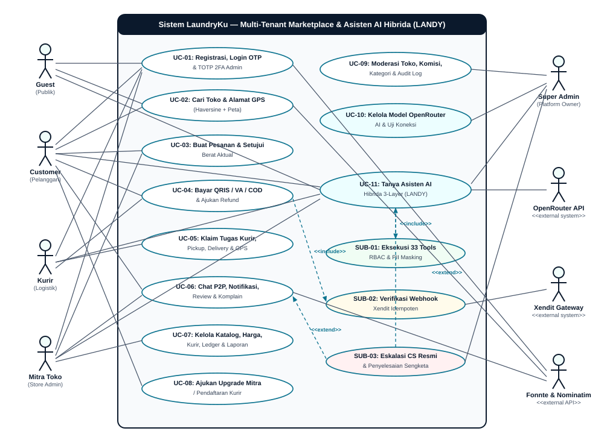

### 2.2 Deskripsi Aktor & Matriks Skenario Use Case

| Aktor | Kategori | Hak Akses & Peran Fungsional |
| :--- | :--- | :--- |
| **Guest** | Aktor Manusia | Akses publik halaman beranda, pencarian toko, pendaftaran akun/login OTP, serta widget LANDY AI mode publik (KB & rekomendasi katalog toko tanpa data privat). |
| **Customer** | Aktor Manusia | Membuat pesanan, mengelola alamat GPS, menyetujui selisih berat aktual, membayar via Xendit/COD, melacak kurir, chat P2P, memberi ulasan/dispute, dan mengajukan upgrade Mitra. |
| **Kurir** | Aktor Manusia | Menerima/mengklaim tugas *pickup* & *delivery* gerai, mengirim koordinat GPS berkala, memverifikasi pembayaran COD tunai (maks. Rp500.000), dan bertanya ke LANDY AI. |
| **Mitra Toko** | Aktor Manusia | Mengelola katalog layanan dan harga per unit, menimbang berat riil pesanan, mengelola status cucian, memverifikasi kurir toko, memantau *settlement payout*, dan ekspor laporan. |
| **Super Admin** | Aktor Manusia | Memoderasi pendaftaran gerai/dokumen, mengatur komisi platform, memantau *audit log* & sengketa, serta mengonfigurasi model OpenRouter LLM dan *guardrail* LANDY AI. |
| **OpenRouter API** | Sistem Eksternal | Menyediakan eksekusi inferensi LLM + *function/tool calling* berbasis model aktif yang dikonfigurasi Super Admin pada tabel `settings`. |
| **Xendit Gateway** | Sistem Eksternal | Menyediakan pembuatan tagihan QRIS/Invoice serta mengirimkan *callback webhook* bertanda tangan `x-callback-token` secara asinkron. |
| **Fonnte & Nominatim** | Sistem Eksternal | Fonnte mengirimkan OTP & notifikasi WhatsApp; Nominatim/OSM menyelesaikan geokode terstruktur dari titik koordinat peta Leaflet. |

### 2.3 Skenario Use Case Inti (`UC-01` s.d. `UC-11`)

#### UC-01 — Registrasi, Login OTP & TOTP 2FA Admin
- **Aktor Utama:** Guest, Customer, Kurir, Mitra Toko, Super Admin · **Aktor Pendukung:** Fonnte API / SMTP.
- **Pre-condition:** Pengguna mengakses halaman login/registrasi dan belum memiliki sesi cookie terautentikasi.
- **Main Flow:** (1) Pengguna memilih portal dan memasukkan email/nomor WhatsApp. (2) Backend (`OtpRegistrationApiController` / `OtpService`) membangkitkan kode OTP acak 6 digit dan menyimpan hash SHA-256 pada `otp_challenges`. (3) `OtpSender` (`FonnteOtpSender` / `LogOtpSender`) mengirimkan OTP. (4) Pengguna memverifikasi OTP; sistem menerbitkan token Sanctum (disimpan BFF sebagai *HTTP-only cookie*). (5) Khusus Super Admin/Platform Owner, verifikasi TOTP 2FA wajib dilakukan sebelum masuk `/admin`.
- **Exception Flow:** Jika OTP salah atau kedaluwarsa, sistem menolak akses (HTTP `422`); percobaan gagal dicatat pada `failed_login_attempts`.
- **Post-condition:** Sesi portal terautentikasi sesuai peran pada `user_roles`.

#### UC-02 — Pencarian Toko Terdekat & Pengelolaan Alamat GPS
- **Aktor Utama:** Guest, Customer · **Aktor Pendukung:** Nominatim OSM / Google Maps.
- **Pre-condition:** Pelanggan berada di `/toko` atau `/customer/addresses`.
- **Main Flow:** (1) Pelanggan menentukan titik koordinat di peta interaktif Leaflet. (2) Frontend memanggil layanan geokode melalui `GeocodingServiceInterface`. (3) Backend menghitung jarak Haversine terhadap kolom `latitude`, `longitude`, dan `radius_km` pada tabel `stores`. (4) Sistem mengurutkan gerai terdekat beserta estimasi ongkos dan layanan aktif.
- **Exception Flow:** Jika gerai di luar radius layanan (`radius_km`), tombol checkout memberi peringatan jangkauan layanan.
- **Post-condition:** Alamat pelanggan tersimpan di `customer_addresses` dan gerai terpilih siap digunakan untuk checkout.

#### UC-03 — Pembuatan Pesanan & Persetujuan Berat Aktual
- **Aktor Utama:** Customer, Mitra Toko.
- **Pre-condition:** Pelanggan login dengan minimal satu item layanan aktif pada gerai terverifikasi.
- **Main Flow:** (1) Pelanggan memilih layanan, mengisi estimasi berat/jumlah item, metode pembayaran (`online` / `cod`), dan alamat. (2) `OrderController::store()` mendelegasikan ke `OrderService::createOrder()` dalam `DB::transaction()` untuk membuat `orders` (status awal `created`), `order_items`, dan `order_status_history`. (3) Kurir menjemput cucian hingga `arrived_at_store`. (4) Mitra menimbang cucian via `OrderService::setActualWeight()`. (5) Jika selisih berat melampaui ambang batas, status berubah ke `waiting_customer_confirmation` agar Customer menyetujui harga akhir (`recalculateFinalPrice()`).
- **Exception Flow:** Jika Customer menolak revisi berat atau melewati batas waktu, order dapat dibatalkan melalui `OrderPolicy::cancel()`.
- **Post-condition:** Harga final terkunci dan status berlanjut ke `payment_required` (atau diproses jika COD).

#### UC-04 — Pembayaran Online Xendit, Verifikasi COD & Refund (`<<include>> SUB-02`)
- **Aktor Utama:** Customer, Kurir, Mitra Toko · **Aktor Pendukung:** Xendit Gateway.
- **Pre-condition:** Pesanan memiliki tagihan aktif pada status `payment_required`.
- **Main Flow:** (1) Customer meminta pembayaran QRIS/VA/E-Wallet via `PaymentController`. (2) `XenditService::createQRCode()` / `createInvoice()` membuat record pada `payments` dengan status `pending`. (3) Setelah dibayar, Xendit memanggil `POST /api/webhooks/xendit` (`SUB-02`). (4) `XenditService::verifyWebhookSignature()` memeriksa `x-callback-token` dan idempotensi `xendit_event_id` pada `payment_events` sebelum mengubah status `orders` menjadi `paid`.
- **Exception Flow:** Pembayaran COD melebihi plafon **Rp500.000** ditolak secara aturan bisnis; pembayaran online melewati `expires_at` bertanda `expired`.
- **Post-condition:** Pembayaran lunas tercatat akurat untuk perhitungan *settlement* mingguan.

#### UC-05 — Penugasan Kurir, Eksekusi Pickup/Delivery & Tracking GPS
- **Aktor Utama:** Kurir, Mitra Toko, Customer.
- **Pre-condition:** Order memasuki tahap siap jemput (`ready_for_pickup`) atau siap antar (`ready_for_delivery`).
- **Main Flow:** (1) `CourierAssignmentService::assignCourier()` memilih kurir gerai terverifikasi dan membuat record pada `courier_tasks` (`pickup` atau `delivery`). (2) Kurir mengklaim/menerima tugas dan menjalankan transisi status (`accepted` → `on_the_way` → `arrived` → `picked_up` / `delivered`). (3) Aplikasi kurir mengirimkan titik lokasi ke `courier_gps` agar dapat dipantau Customer dan Mitra.
- **Exception Flow:** Jika kurir menolak tugas (`handleRejection`), tugas dilempar ulang ke antrean klaim kurir gerai atau ditugaskan ulang oleh Mitra.
- **Post-condition:** Cucian tiba di gerai atau diterima oleh Customer (`delivered` → `completed`).

#### UC-06 — Chat P2P, Notifikasi Multi-Channel, Review & Sengketa (`<<extend>> SUB-03`)
- **Aktor Utama:** Customer, Mitra Toko, Super Admin · **Aktor Pendukung:** Fonnte WA / Email.
- **Pre-condition:** Pesanan aktif atau selesai antara Customer dan Mitra.
- **Main Flow:** (1) Customer/Mitra membuka percakapan terikat `order_id` (`conversations` & `chat_messages`). (2) Perubahan status order memicu `NotificationService::notify()` yang menyebarkan pesan melalui kanal `InAppChannel`, `EmailChannel`, dan `WhatsAppChannel`. (3) Setelah selesai, Customer mengirim `reviews` (rating 1–5) yang memperbarui `average_rating` gerai.
- **Exception Flow (`<<extend>> SUB-03`):** Jika terdapat ketidaksesuaian cucian atau pembayaran, Customer membuka `disputes` yang memicu log `dispute_events` untuk ditangani Super Admin (`refunds`).
- **Post-condition:** Seluruh komunikasi dan resolusi sengketa terdokumentasi permanen.

#### UC-07 & UC-08 — Operasional Mitra Toko & Pengajuan Upgrade Mitra/Kurir
- **UC-07 (Mitra Toko):** Mitra mengelola jenis layanan (`services`, `service_prices`, `laundry_packages`), memverifikasi staf & kurir internal, memverifikasi setoran tunai COD kurir (`cod_collections`), memantau rincian `settlement_periods` / `settlement_items`, dan mengunduh laporan transaksi.
- **UC-08 (Upgrade Mitra/Kurir):** Customer mengajukan permohonan pembukaan toko baru (`store_applications` + dokumen legalitas `store_documents` + rekening bank `store_payout_accounts`) atau mendaftar sebagai kurir. Status awal `draft`/`submitted` menunggu peninjauan Super Admin.

#### UC-09 & UC-10 — Tata Kelola Super Admin & Konfigurasi OpenRouter AI
- **UC-09 (Tata Kelola Platform):** Super Admin menyetujui/menolak aplikasi gerai (`StorePolicy`), mengatur tarif komisi persentase/nominal (`commission_settings`), memverifikasi *payout settlement* mingguan, serta mengaudit perubahan data pada `audit_logs`.
- **UC-10 (Konfigurasi AI Admin):** Pada `/admin/settings/ai`, Super Admin mengelola daftar model **OpenRouter** (menyimpan `active_model`, `temperature`, `max_tool_rounds`, *system prompt* ke `settings`), melakukan sinkronisasi/pemilihan model gratis maupun berbayar, serta menjalankan **Uji Koneksi AI** (`AiAssistantService::testModelConnection()`) sebelum diterapkan ke seluruh portal.

#### UC-11 — Tanya Asisten AI Hibrida 3-Layer LANDY (`<<include>> SUB-01`, `<<extend>> SUB-03`)
- **Aktor Utama:** Guest, Customer, Kurir, Mitra Toko, Super Admin · **Aktor Pendukung:** OpenRouter API.
- **Pre-condition:** Pengguna membuka `AiChatWidget` atau riwayat percakapan di portal masing-masing.
- **Main Flow:** (1) Pengguna mengirim pertanyaan berbahasa alami (termasuk typo atau *slang*). (2) `AiTextNormalizer` dan `AiTopicGuardrail` memeriksa kelayakan topik serta mendeteksi *prompt injection* (`looksLikeInjection`). (3) `AiIntentRouter` mengevaluasi **Layer 1 (KB 21 topik & Query Data deterministik 0-token)**. Jika terjawab lokal, respons dikembalikan instan tanpa memanggil OpenRouter. (4) Jika kompleks, sistem melanjutkannya ke **Layer 2/3** memanggil `OpenAiClient::chat()` dengan daftar *tool* sesuai izin peran (`AiToolRegistry::definitionsForUser()` — total **33 tools**). (5) Hasil `tool_calls` diproteksi *Policy* & *PII masking* (`maskPhone`, `maskEmail`, `maskPlate`, `maskCustomerName`), lalu jawaban final disimpan ke `ai_messages` dan `ai_usage_logs`.
- **Exception Flow:** Pertanyaan di luar domain atau mengandung pola injeksi diblokir aman (`0` token) disertai ajakan eskalasi CS resmi `cs@laundryku.test` (`SUB-03`).
- **Post-condition:** Percakapan dan metrik pemakaian token tersimpan rapi untuk audit biaya & performa.

---

## Bab 3 — Activity Diagram (Alur Bisnis Inti & Pipeline AI LANDY)

### 3.1 Activity Diagram A — Siklus Pesanan End-to-End, Penimbangan & Pembayaran

Diagram aktivitas berikut memetakan alur kerja paralel lintas 5 *swimlane* (**Customer**, **Next.js BFF & Laravel API**, **Kurir**, **Mitra Toko**, dan **Xendit Gateway**), termasuk titik percabangan revisi berat aktual dan pemilihan kanal bayar Online vs COD.

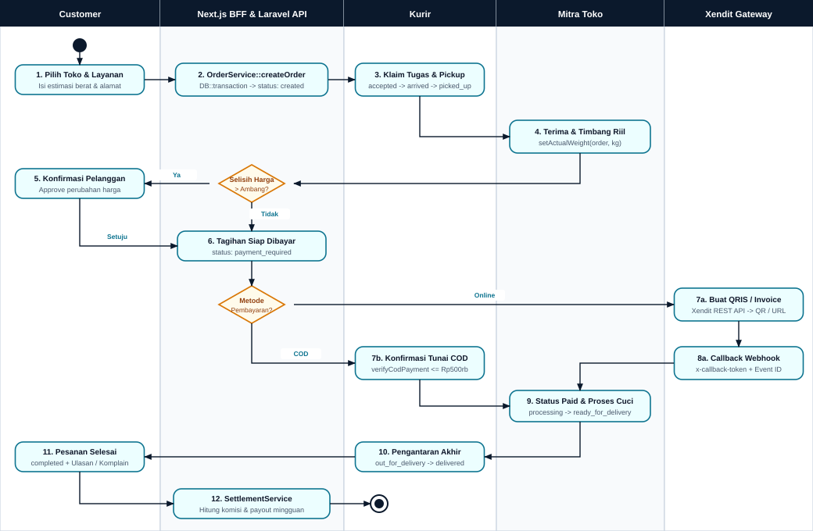

**Analisis Keputusan Kritis pada Activity Diagram A:**
- **Percabangan Selisih Berat (`> Ambang?`):** Setelah kurir menyerahkan cucian dan Mitra memanggil `setActualWeight()`, sistem menjaga keadilan harga dengan menahan transaksi pada status `waiting_customer_confirmation` bila deviasi berat melebihi toleransi. Order tidak berlanjut ke pencucian sampai Customer memberikan persetujuan eksplisit.
- **Percabangan Kanal Bayar (`Online vs COD`):** Pembayaran Online diarahkan ke `XenditService` dan baru dianggap lunas oleh *callback webhook* bertanda tangan valid; sedangkan COD mewajibkan konfirmasi serah terima tunai (`verifyCodPayment`) dengan batas transaksi maksimal Rp500.000.

### 3.2 Activity Diagram B — Pipeline Asisten AI Hibrida 3-Layer (LANDY)

Diagram aktivitas kedua menguraikan bagaimana arsitektur hibrida 3-layer LaundryKu menyeimbangkan efisiensi biaya token OpenRouter, akurasi data *real-time* dari MySQL 8, dan perlindungan privasi/keamanan.

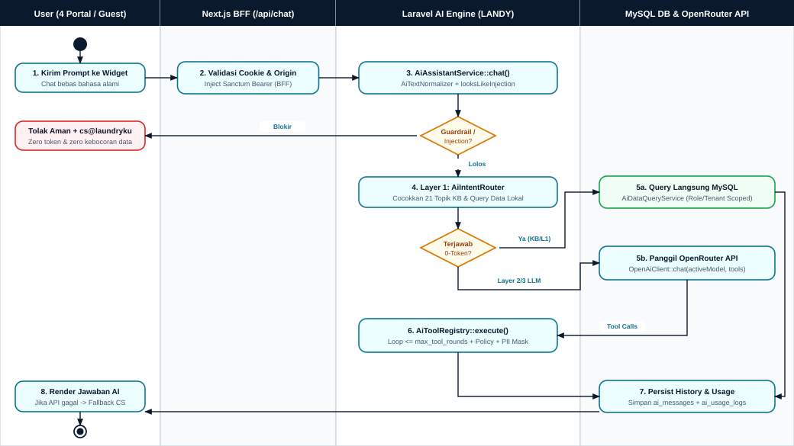

**Analisis Penghematan & Keamanan pada Activity Diagram B:**
- **Gerbang *Guardrail* & *Anti-Injection* Awal:** Permintaan di luar konteks laundry atau upaya manipulasi instruksi (*jailbreak*/*SQL probing*) langsung dihentikan di lapisan Laravel sebelum menyentuh kuota OpenRouter.
- **Jalur Cepat 0-Token (Layer 1):** Pertanyaan FAQ statis (21 topik Knowledge Base) dan kueri status/statistik terstruktur langsung dieksekusi oleh `AiIntentRouter` + `AiDataQueryService` tanpa biaya LLM (*zero token*), dengan akurasi teruji **165/165 pada evaluasi *hold-out*** (`prd.md` §4.1).
- **Eksekusi *Tool-Calling* Terkontrol (Layer 2/3):** Untuk pertanyaan terbuka, `AiToolRegistry::execute()` membatasi jumlah putaran (`max_tool_rounds`), memfilter alat berdasarkan hak peran pemanggil, serta menyensor PII sebelum data dikirimkan ke OpenRouter API.

---

## Bab 4 — Class Diagram & Pembuktian Prinsip SOLID

Rancangan kelas backend LaundryKu memisahkan tanggung jawab secara ketat agar *maintainability* tetap tinggi seiring bertambahnya layanan ekspedisi, kanal notifikasi, maupun penyedia model AI.

### 4.1 Class Diagram Bagian A — Domain Marketplace, Order, Payment & Policy

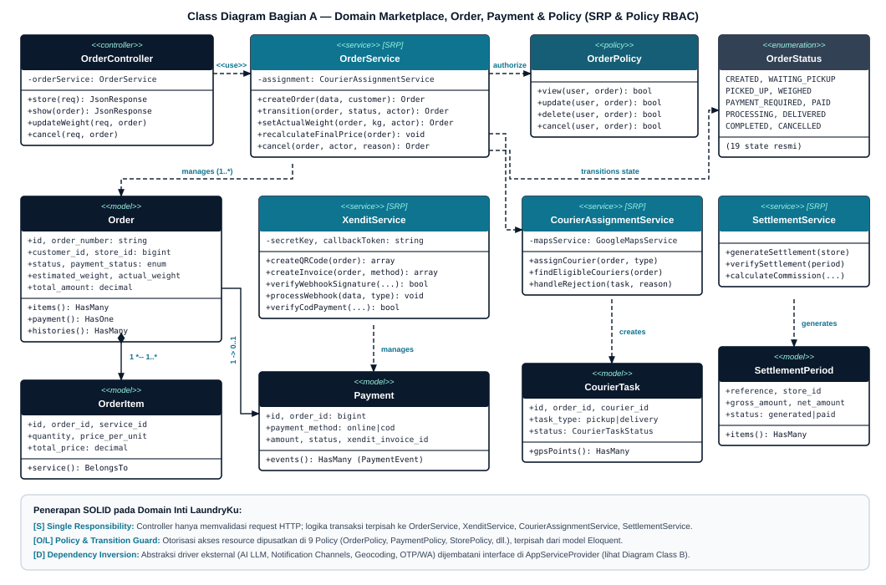

### 4.2 Class Diagram Bagian B — Abstraksi SOLID: LANDY AI, Notification, Geocoding & OTP

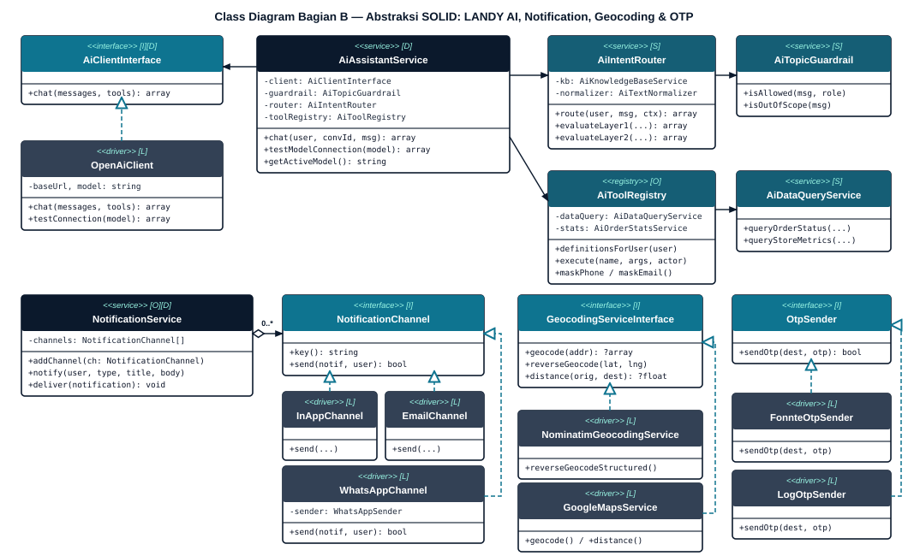

### 4.3 Matriks Pembuktian Kepatuhan Prinsip SOLID

| Prinsip SOLID | Penerapan Nyata pada Arsitektur & Kelas LaundryKu | Dampak Rekayasa |
| :--- | :--- | :--- |
| **S — Single Responsibility Principle (SRP)** | `OrderController` hanya menerima & memvalidasi HTTP *request*. Logika transisi state diisolasi di `OrderService`, transaksi gateway di `XenditService`, penjadwalan kurir di `CourierAssignmentService`, rekonsiliasi dana di `SettlementService`, serta pemisahan `AiTopicGuardrail`, `AiIntentRouter`, dan `AiDataQueryService`. | Setiap kelas memiliki satu alasan berubah; *unit testing* dapat fokus pada layanan tanpa ketergantungan HTTP. |
| **O — Open/Closed Principle (OCP)** | `NotificationService` mengelola array `NotificationChannel` dan menyediakan metode `addChannel(NotificationChannel)` sehingga kanal baru (misal *Push Notification* FCM) dapat ditambahkan tanpa mengubah inti logika `deliver()`. Demikian pula `AiToolRegistry` mendaftarkan *tool* secara deklaratif per peran. | Penambahan fitur notifikasi atau kapabilitas AI tidak merusak kode inti yang sudah stabil. |
| **L — Liskov Substitution Principle (LSP)** | Setiap implementasi konkret dapat menggantikan antarmukanya secara transparan pada lingkungan *production* maupun *testing*: `OpenAiClient` menggantikan `AiClientInterface`; `InAppChannel`/`EmailChannel`/`WhatsAppChannel` menggantikan `NotificationChannel`; `GoogleMapsService` & `NominatimGeocodingService` menggantikan `GeocodingServiceInterface`; `FonnteOtpSender` & `LogOtpSender` menggantikan `OtpSender`. | Lingkungan lokal/CI dapat menjalankan `LogOtpSender` dan `NominatimGeocodingService` tanpa biaya API berbayar dengan perilaku kontrak identik. |
| **I — Interface Segregation Principle (ISP)** | Antarmuka dipecah spesifik sesuai domain tugasnya: `AiClientInterface` hanya mewajibkan `chat()`; `OtpSender` hanya mewajibkan `sendOtp()`; `NotificationChannel` hanya `key()` dan `send()`; `GeocodingServiceInterface` terpisah dari `WhatsAppSender`. | Tidak ada driver eksternal yang dipaksa mengimplementasikan metode kosong di luar kapabilitasnya. |
| **D — Dependency Inversion Principle (DIP)** | `AiAssistantService`, `NotificationService`, `CourierAssignmentService`, dan `OtpService` bergantung pada abstraksi *interface* yang di-*inject* via konstruktor/Container `AppServiceProvider`, bukan menginstansiasi langsung driver konkret OpenRouter, Fonnte, atau Google Maps. | Pergantian vendor LLM, gateway WA, atau layanan peta hanya memerlukan perubahan *binding* di Service Provider. |

---

## Bab 5 — Sequence Diagram (Interaksi Frontend, Backend, DB & AI/Payment API)

### 5.1 Sequence Diagram A — Alur Pesan Chat AI Hibrida (`User ↔ BFF ↔ Laravel ↔ MySQL ↔ OpenRouter`)

Sequence Diagram A menggambarkan urutan kronologis pertukaran pesan sinkron dan percabangan `alt` antara **Layer 1 (0-token)** dengan **Layer 2/3 (LLM + Tool Calling Loop)** saat pengguna mengirim pesan pada `AiChatWidget`.

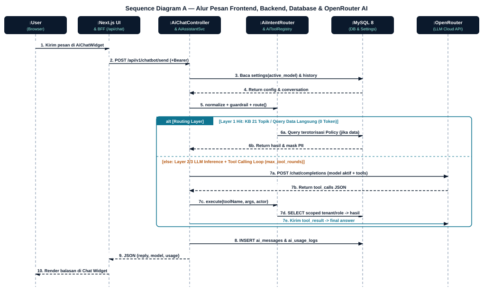

**Kontrak Pertukaran Pesan Kunci (Sequence Diagram A):**
1. **Keamanan Batas BFF:** Browser tidak pernah berkomunikasi langsung ke OpenRouter maupun mengirim token Sanctum mentah di JavaScript; Next.js `/api/chat` bertindak sebagai BFF tepercaya.
2. **Konfigurasi Dinamis dari Basis Data:** `AiAssistantService` membaca baris `active_model` dan riwayat pesan pada `MySQL 8` terlebih dahulu sebelum melakukan *routing*, sehingga model yang diganti oleh Super Admin langsung berlaku *real-time*.
3. **Loop *Tool-Calling* Aman:** Ketika OpenRouter mengembalikan struktur `tool_calls`, eksekusi tetap berlangsung di server Laravel (`AiToolRegistry::execute`) dengan *Policy guard* dan penyensoran PII sebelum hasilnya dikirim kembali ke OpenRouter untuk sintesis jawaban final.

### 5.2 Sequence Diagram B — Alur Checkout Pesanan & Callback Webhook Idempoten Xendit

Sequence Diagram B memperlihatkan transaksi atomik pembuatan pesanan hingga pemrosesan *callback webhook* Xendit yang berlangsung secara asinkron serta dilindungi mekanisme anti-duplikasi (*idempotency*).

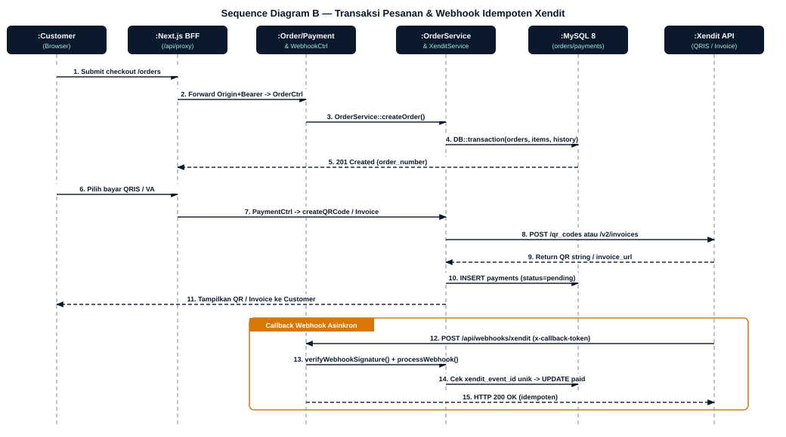

**Kontrak Pertukaran Pesan Kunci (Sequence Diagram B):**
1. **Transaksi Atomik (`DB::transaction`):** Pembuatan baris pada `orders`, `order_items`, dan `order_status_history` dilakukan dalam satu transaksi tunggal agar tidak pernah tercipta pesanan tanpa rincian layanan.
2. **Idempotensi Callback Webhook:** Saat Xendit mengirim `POST /api/webhooks/xendit`, `XenditService` memvalidasi `x-callback-token` dan mengecek keunikan `xendit_event_id` pada tabel `payment_events`. Jika webhook yang sama dikirim ulang akibat *network retry*, sistem tetap mengembalikan `HTTP 200 OK` tanpa memicu transisi status ganda.

---

## Bab 6 — Entity Relationship Diagram (ERD) & Kamus 58 Tabel MySQL 8

Basis data **LaundryKu** pada **MySQL 8** terdiri atas **58 tabel aktual** yang dikelola melalui **74 skrip migrasi**. Untuk menjaga keterbacaan visual dengan notasi *Crow's Foot*, ERD dipetakan menjadi dua diagram yang saling melengkapi: **ERD Bagian A** (entitas inti transaksional) dan **ERD Bagian B** (sub-domain RBAC, onboarding mitra, komunikasi, dan tata kelola).

### 6.1 ERD Bagian A — Entitas Inti Transaksional (Order, Logistik, Payment, Settlement & AI)

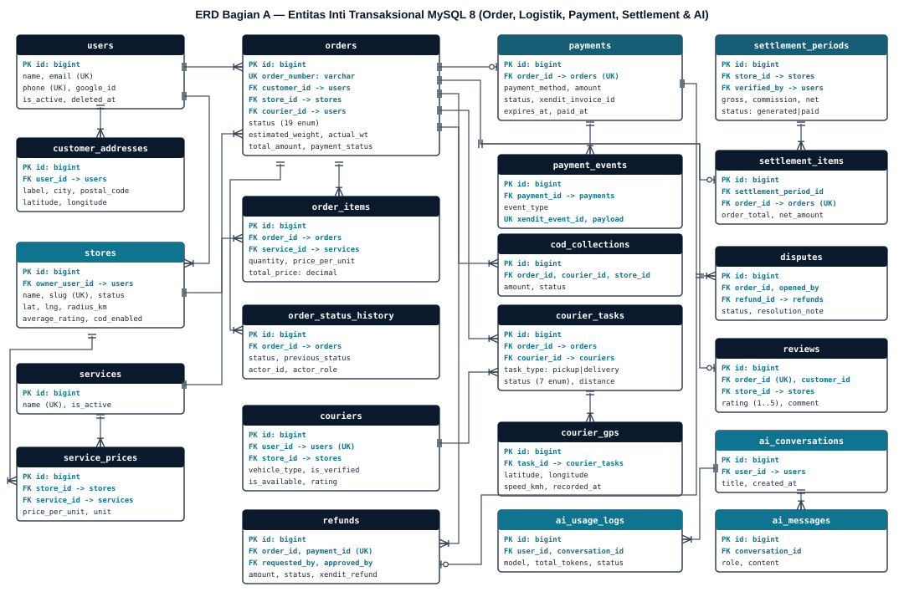

### 6.2 ERD Bagian B — Sub-Domain RBAC, Onboarding Toko, Komunikasi & Tata Kelola

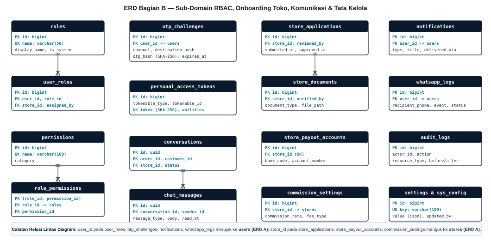

### 6.3 Kamus Relasi Kunci (PK, FK & Kardinalitas Utama)

| Tabel Anak | Foreign Key / Unique Key | Merujuk ke (Parent) | Kardinalitas | Aturan Integritas Bisnis |
| :--- | :--- | :--- | :---: | :--- |
| `stores` | `FK owner_user_id` | `users(id)` | `1 : 0..*` | Satu pemilik dapat mengelola gerai terverifikasi dengan `slug` unik dan radius layanan GPS. |
| `orders` | `FK customer_id`, `store_id`, `courier_id`, `UK order_number` | `users(id)`, `stores(id)` | `1 : 0..*` | Nomor pesanan unik; status mengikuti 19 enum `OrderStatus`; berat riil menentukan harga final. |
| `order_items` | `FK order_id`, `FK service_id` | `orders(id)`, `services(id)` | `1 : 1..*` | Komposisi wajib minimal 1 layanan per order (`cascadeOnDelete`). |
| `payments` | `FK order_id (UK)`, `UK xendit_invoice_id` | `orders(id)` | `1 : 0..1` | Satu pesanan memiliki maksimal satu record pembayaran aktif; batas COD Rp500.000. |
| `payment_events` | `FK payment_id`, `UK xendit_event_id` | `payments(id)` | `1 : 0..*` | Kunci unik `xendit_event_id` menjamin pemrosesan webhook Xendit bersifat idempoten. |
| `courier_tasks` | `FK order_id`, `FK courier_id` | `orders(id)`, `couriers(id)` | `1 : 0..*` | Tugas terpisah untuk `pickup` dan `delivery` (7 enum `CourierTaskStatus`). |
| `courier_gps` | `FK task_id` | `courier_tasks(id)` | `1 : 0..*` | Jejak koordinat kurir berkala selama penugasan aktif berlangsung. |
| `settlement_items` | `FK settlement_period_id`, `FK order_id (UK)` | `settlement_periods(id)`, `orders(id)` | `1 : 1..*` / `1 : 0..1` | Kunci unik `order_id` mencegah satu pesanan masuk ke dua periode *payout* berbeda. |
| `disputes` | `FK order_id`, `FK opened_by`, `FK refund_id` | `orders(id)`, `users(id)`, `refunds(id)` | `1 : 0..*` | Mencatat sengketa pesanan beserta tautan resolusi pengembalian dana. |
| `ai_messages` | `FK conversation_id` | `ai_conversations(id)` | `1 : 0..*` | Menyimpan riwayat tanya-jawab *multi-turn* LANDY AI terisolasi per pengguna. |
| `ai_usage_logs` | `FK user_id`, `FK conversation_id` | `users(id)`, `ai_conversations(id)` | `1 : 0..*` | Mencatat model aktif, `total_tokens`, latensi, dan status eksekusi AI untuk observabilitas. |

### 6.4 Inventaris Lengkap 58 Tabel Basis Data Aktual (6 Domain)

| No | Domain Data | Jml | Daftar Nama Tabel Aktual (`database/schema_full.sql` + Migrasi Terkini) |
| :-: | :--- | :-: | :--- |
| 1 | **Autentikasi, Sesi & RBAC** | 11 | `users`, `roles`, `permissions`, `user_roles`, `role_permissions`, `personal_access_tokens`, `otp_challenges`, `failed_login_attempts`, `password_reset_tokens`, `password_resets`, `sessions` |
| 2 | **Pelanggan, Mitra Toko, Katalog & Kurir** | 13 | `customers`, `customer_addresses`, `stores`, `store_applications`, `store_documents`, `store_staff`, `store_settings`, `store_payout_accounts`, `services`, `service_prices`, `laundry_packages`, `couriers`, `courier_gps` |
| 3 | **Siklus Pesanan & Penugasan** | 4 | `orders`, `order_items`, `order_status_history`, `courier_tasks` |
| 4 | **Pembayaran, COD, Refund, Settlement & Ulasan** | 11 | `payments`, `payment_events`, `xendit_webhooks`, `cod_collections`, `refunds`, `commission_settings`, `settlement_periods`, `settlement_items`, `disputes`, `dispute_events`, `reviews` |
| 5 | **Chat P2P, Notifikasi & Asisten AI (LANDY)** | 10 | `conversations`, `chat_messages`, `notifications`, `notification_preferences`, `whatsapp_logs`, `ai_conversations`, `ai_messages`, `ai_chat_sessions`, `ai_chat_messages`, `ai_usage_logs` |
| 6 | **Tata Kelola, Konfigurasi & Antrean Laravel** | 9 | `settings`, `system_configurations`, `audit_logs`, `dashboard_metric_caches`, `cache`, `cache_locks`, `jobs`, `job_batches`, `failed_jobs` |
| | **Total Keseluruhan** | **58** | Selaras penuh dengan `prd.md` §6.3 dan hasil verifikasi skema MySQL 8 |

---

## Bab 7 — Prototipe Interaktif UI/UX (FigCraft & Ekspor Figma)

### 7.1 Spesifikasi Design System & Token Visual (`DESIGN.md`)

Seluruh 66 layar antarmuka (varian **Desktop 1440px** dan **Mobile 390px**) dirancang di atas satu sumber kebenaran desain (**`ui-ux-prototipe/laundryku_design_system.figcraft`**) menggunakan token resmi:
- **Palet Warna:** Primary Deep Navy (`#0B192C`), Accent Teal/Cyan (`#14B8A6` & `#0E7490` untuk portal operasional/AI Admin), Warm Amber (`#F59E0B`), Surface Slate (`#F8FAFC` / `#FFFFFF`), serta semantik status terkontrol.
- **Tipografi:** **Plus Jakarta Sans** untuk *headline/display* dan **Inter** untuk isi teks, tabel keuangan, serta kontrol formulir.

### 7.2 Inventaris 4 Flow Prototipe Interaktif & Cakupan Koneksi

Prototipe telah dihubungkan secara terstruktur pada berkas `.figcraft` dan diekspor menjadi berkas `.fig` standar agar dapat diimpor dan dimainkan pada Figma Web/Desktop. Hasil pemeriksaan grafik struktural menunjukkan **282 interaksi klik-navigasi aktif**, **48 frame terhubung penuh**, dan **0 tautan tujuan rusak (*broken destinations*)**.

| Flow ID | Nama Alur Prototipe | Titik Awal (Start Node) | Cakupan Navigasi & Layar Utama |
| :---: | :--- | :---: | :--- |
| **Flow 1** | **Customer Journey (Desktop 1440px)** | `#395` (`01_Beranda_Desktop`) | Beranda → Cari Toko Terdekat → Detail Toko & Layanan → Checkout Order → Pembayaran QRIS/VA → Pesanan Saya & Lacak Kurir → Chat P2P → Profil/Alamat + Widget LANDY AI. |
| **Flow 2** | **Customer & Kurir Journey (Mobile 390px)** | `#461` (`01_Beranda_Mobile`) | Seluruh alur Customer responsif pada viewport 390px terhubung silang hingga alur login & tugas Kurir Mobile (Klaim Tugas, Update GPS, Verifikasi COD). |
| **Flow 3** | **Mitra Toko & Kurir (Desktop 1440px)** | `#4777` (`Mitra_01_Dashboard`) | Navigasi *sidebar mesh* penuh 9 layar Mitra (Dashboard, Pesanan, Detail Timbang Berat, Katalog Layanan, Harga, Pembayaran/Settlement, Kurir, Laporan, Pengaturan Toko) + tautan ke Dashboard Kurir. |
| **Flow 4** | **Super Admin & AI Config (Desktop 1440px)** | `#7622` (`Admin_01_Dashboard`) | Navigasi *sidebar mesh* penuh 9 layar Super Admin (Dashboard Platform, Verifikasi Mitra, Kategori Layanan, Keuangan & Payout, Sengketa/Dispute, **Konfigurasi Model AI OpenRouter**, Komisi Platform, Audit Log, Pengaturan). |

### 7.3 Pratinjau Visual Layar Kunci Prototipe

| Beranda Publik & Pencarian Cepat | Katalog Cari Toko Terdekat (Customer) |
| :---: | :---: |
| 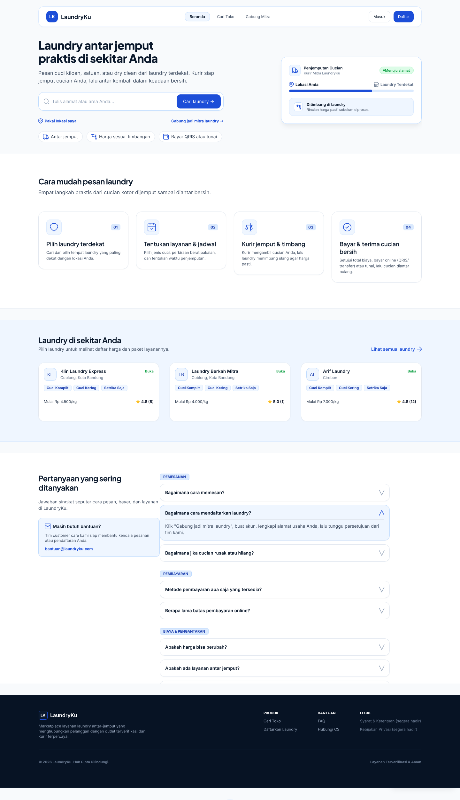 | 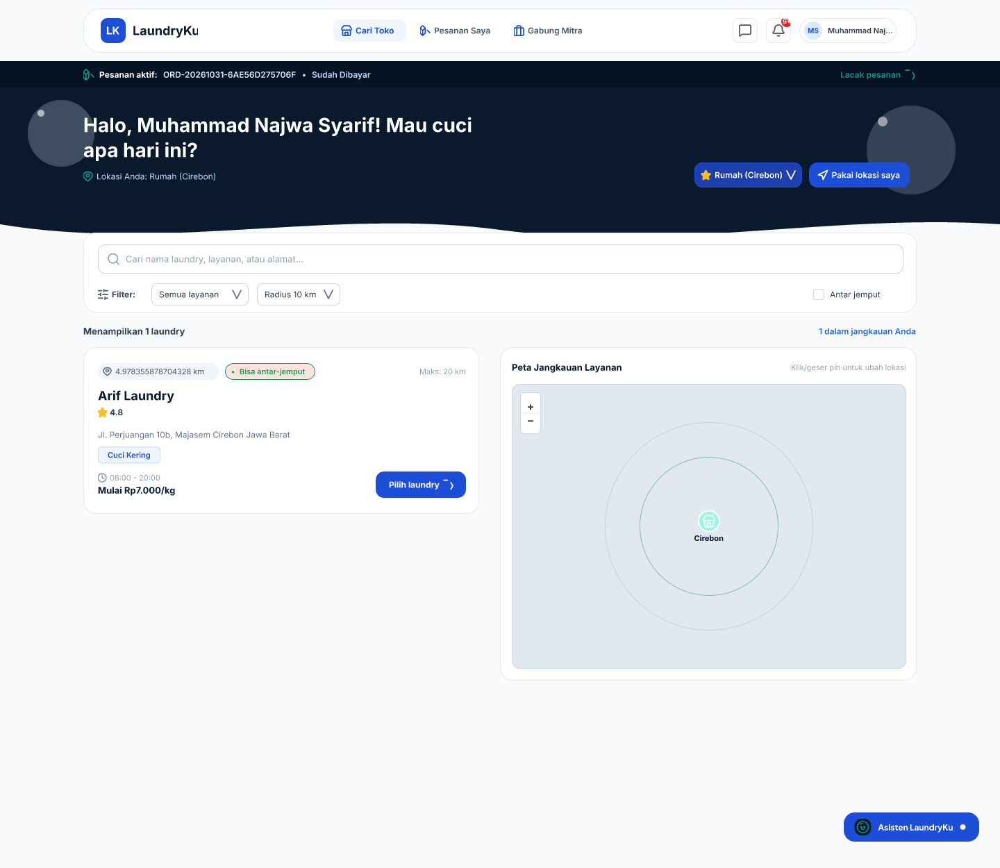 |
| **Riwayat & Pelacakan Pesanan Customer** | **Dashboard Tugas & Pengiriman Kurir** |
| 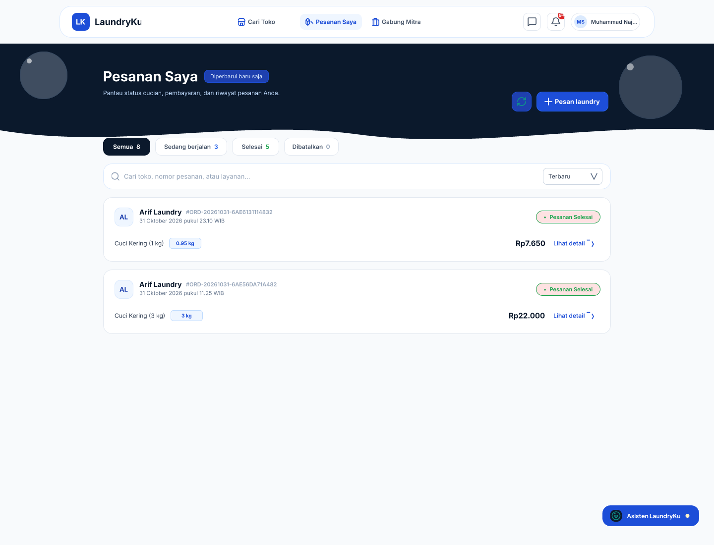 | 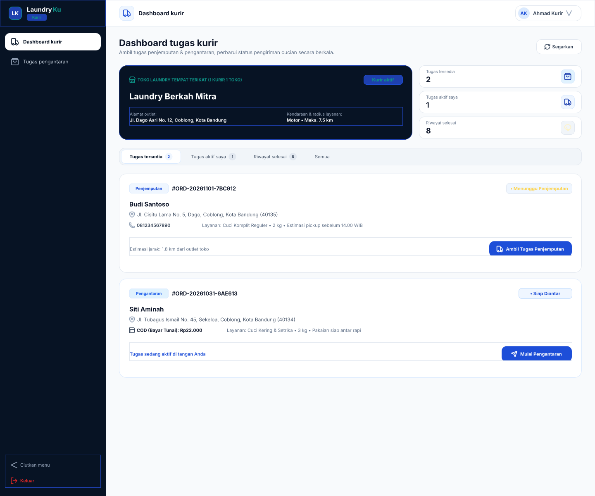 |
| **Dashboard Operasional Mitra Toko** | **Konfigurasi Model AI OpenRouter (Super Admin)** |
| 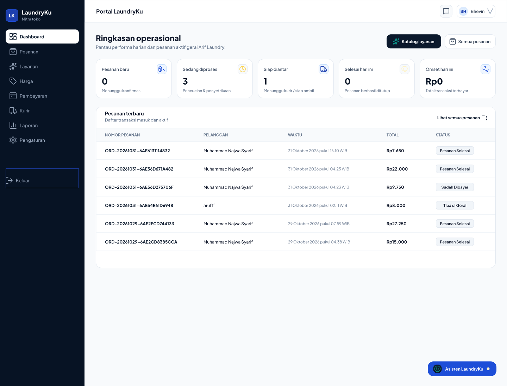 | 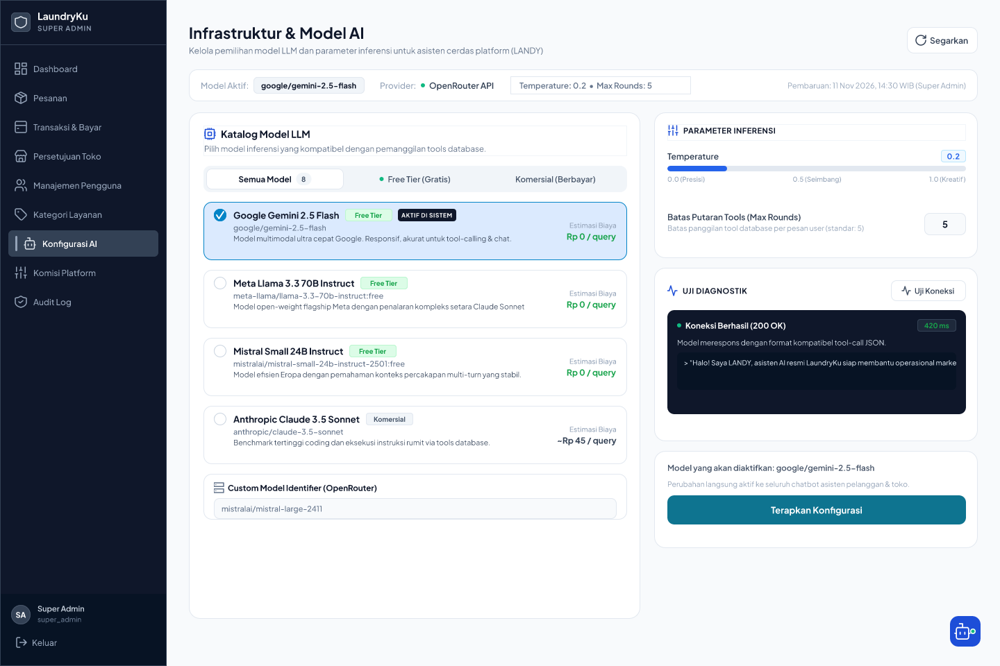 |

### 7.4 Panduan Impor & Uji Klik Prototipe di Figma Web/Desktop

1. **Berkas Sumber Utama:** Buka `ui-ux-prototipe/laundryku_design_system.figcraft` di aplikasi desktop **FigCraft** dan jalankan mode **Prototype Play** pada masing-masing Flow (`Flow 1` s.d. `Flow 4`) untuk demonstrasi langsung di komputer lokal.
2. **Berkas Portabel Figma (`.fig`):** Untuk kebutuhan unggah/kolaborasi cloud Figma atau perekaman Video Progres 2 di browser Figma:
   - Buka **Figma** (`figma.com` atau Figma Desktop) → pilih **Import** → unggah berkas **`ui-ux-prototipe/laundryku-uiux-prototype.fig`**.
   - **Verifikasi Manual Pascaimpor:** Karena format ekspor `.fig` bersifat eksperimental, periksa keselarasan font *Plus Jakarta Sans / Inter* serta klik *Present (Play)* untuk memastikan seluruh *hotspot* klik antar-frame bekerja mulus sebelum perekaman Video Progres 2 dimulai.
